# Testing the Fluorescence Advantage: Does Solar-Induced Fluorescence Signal Agricultural Drought Earlier than NDVI in Marathwada, India?

Sakshi D. Maske

Independent Geospatial Researcher, Nagpur, Maharashtra, India

ORCID: [0009-0002-5683-5966](https://orcid.org/0009-0002-5683-5966)

Corresponding author: [sakshimaske303@gmail.com](mailto:sakshimaske303@gmail.com)

## Highlights

- Against normal years, GOSIF SIF did not flag drought earlier than NDVI in Marathwada.
- Where both flagged a drought district-year, they mostly coincided or NDVI came first.
- SIF's "seasonal lead" over NDVI depends on how each curve is normalised.
- Measured from peak to post-peak minimum, the lead shrinks to 0–13 days and vanishes in 3 of 9 years.
- An approximation of India's rainfall Trigger-1 rarely fired; satellite anomalies were usually earlier.

## Abstract

Drought declarations in India, and the crop-insurance payouts (PMFBY) tied to them, rest on rainfall deficits and on vegetation indices such as NDVI. Solar-Induced Fluorescence (SIF), being tied to photosynthesis, is often expected to show drought stress earlier. I test that expectation for the eight districts of Marathwada, Maharashtra, over nine Kharif seasons (2015–2023), comparing cropland-weighted GOSIF SIF with MODIS NDVI dated to each pixel's observation day. The main question is whether SIF departs from its normal-year range earlier than NDVI in drought. Standardised against normal years, it did not: at the regional scale both crossed z < −3 on the same date in 2015 and NDVI was eight days earlier in 2018; across the 15 drought district-years (each district against its own rainfall baseline), SIF and NDVI flagged 12 and 13, and where both did, they coincided in 6, NDVI was earlier in 5 and SIF in 1. At looser thresholds NDVI was earlier in most cases. A secondary question is whether SIF's normal seasonal decline starts before NDVI's. With each year scaled from its seasonal minimum to its peak, SIF crossed decline thresholds first in all nine years (8.0–34.2 days) and all 72 district-years. But NDVI in this region does not return to its pre-season level after the monsoon, so this scaling places NDVI's decline later by construction; scaled from peak to post-peak minimum, the lead falls to −5.5 to +13.4 days, SIF is first in six years, and the district differences disappear (Friedman p = 0.97). TROPOMI SIF (2018–2020), which is not built from MODIS reflectance, was first under both scalings. Only 2015 and 2018 met the rainfall drought criterion, and the lead was not larger in them. An approximation of the rainfall-based Trigger-1, with dry spells counted inside the monsoon, never fired for the region and fired in 2 of 15 drought district-years. In this dataset SIF is not an earlier drought alarm than NDVI, and its seasonal lead is largely a property of how NDVI's decline is measured.

## 1. Introduction

### 1.1 Motivation

NDVI is a reflectance-based measure: it tracks how much red and near-infrared light a canopy reflects, and it changes once leaf area, structure or chlorophyll content change. SIF works on a different physical principle. When a leaf absorbs sunlight, a small part of that energy is re-emitted as fluorescence, and the share depends on how the leaf is using the light. Photosynthetic efficiency can drop under stress before greenness does, so SIF should, in principle, show stress earlier than NDVI. Whether that physical head start appears as a measurable timing difference in the satellite products available for operational use is the empirical question this study tests.

India's drought-declaration process, and the PMFBY crop-insurance payouts tied to it, lean heavily on rainfall deficit and NDVI (Ministry of Agriculture & Farmers Welfare, 2016a, 2016b; Down To Earth, 2025). Two different things are often run together when SIF is proposed as an earlier indicator: SIF starting its normal seasonal decline before NDVI does, and SIF departing from its normal-year behaviour earlier than NDVI does in a drought year. Only the second would make SIF a better drought alarm. This study tests both, separately, and treats the second as the main question.

### 1.2 Previous Work and Research Gap

Satellite SIF responds to drought: GOME-2 and OCO-2 SIF fell during the 2011–2014 drought in Texas and California, in step with gross primary production (Sun et al., 2015), and in India's Indo-Gangetic Plains GOME-2 SIF showed the response of winter wheat to heat stress earlier than reflectance-based indices (Song et al., 2018). Whether it responds *before* greenness is less settled. Several studies find that much of the SIF signal at canopy scale follows absorbed light and canopy structure rather than fluorescence yield (Yoshida et al., 2015; Dechant et al., 2020), so SIF and a structural index such as NIRv (Badgley et al., 2017) can move together. Reviews of SIF for vegetation stress (Mohammed et al., 2019; Porcar-Castell et al., 2014) list early stress detection as a promise that depends on separating the yield signal from these structural effects.

Most studies of SIF lead times compare seasonal curves, or compare SIF and vegetation-index anomalies over large regions with coarse SIF retrievals. Few test, at the district scale used for drought declarations, whether a SIF *anomaly* precedes an NDVI anomaly in independently identified drought years, and few check how sensitive a "seasonal lead" is to the way each curve is normalised — a known issue in phenology extraction (Zhang et al., 2003; Jönsson & Eklundh, 2004), because NDVI and other reflectance indices saturate over dense canopies and differ in their post-season baseline (Huete et al., 2002). This study addresses both, for the district-level setting in which Indian drought declarations are made.

### 1.3 Physical Basis of Solar-Induced Fluorescence

A leaf absorbing photosynthetically active radiation splits that energy across three competing pathways: photochemistry (Φ_P), non-photochemical quenching or heat dissipation (Φ_NPQ), and chlorophyll fluorescence (Φ_F):

Φ_P + Φ_NPQ + Φ_F = 1

Under well-watered conditions most absorbed energy goes to photochemistry and a small, fairly stable share is emitted as fluorescence. Under drought or heat stress, photochemistry is down-regulated and non-photochemical quenching increases; the fluorescence yield changes as this happens, before any change in canopy structure (Porcar-Castell et al., 2014; Figure 1).

The signal measured by a satellite is

SIF = APAR × Φ_F × f_esc

where APAR is absorbed photosynthetically active radiation, Φ_F the fluorescence quantum yield and f_esc the fraction of emitted photons that escape the canopy. Because APAR and f_esc depend on canopy structure, much of the variation in canopy SIF can come from structure rather than from Φ_F (Dechant et al., 2020). Satellite instruments such as GOME-2, OCO-2 and TROPOMI retrieve SIF in Fraunhofer lines, where the small fluorescence contribution can be separated from reflected sunlight. The GOSIF product used here as the main SIF source is not a direct retrieval but a statistical reconstruction from OCO-2 soundings, MODIS reflectance and meteorological reanalysis (Li & Xiao, 2019). TROPOMI SIF, used as an independent check, is a direct retrieval.

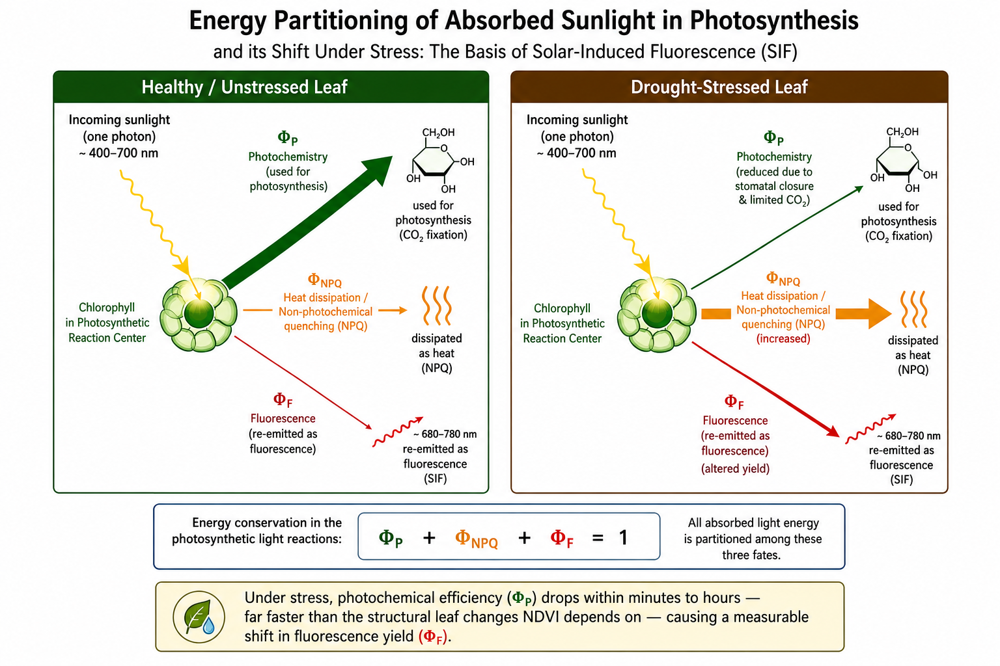

**Figure 1.** Schematic representation of leaf-level light energy partitioning among photochemistry, non-photochemical quenching (heat dissipation), and chlorophyll fluorescence, under well-watered versus drought-stressed conditions. *Illustration generated with an AI image tool, used only as a visual aid; it is not data or a result of this study.*

### 1.4 Physical Basis of NDVI

NDVI comes from surface reflectance in the red and near-infrared bands:

NDVI = (NIR − RED) / (NIR + RED)

Chlorophyll absorbs red light strongly, so red reflectance from healthy leaves is low, while the internal structure of the leaf — the air–cell-wall interfaces in the spongy mesophyll — scatters near-infrared light strongly (Figure 2). A dense, healthy canopy therefore has a large red/near-infrared contrast and a high NDVI; a thinning or senescing canopy narrows the contrast. NDVI saturates over dense canopies (Huete et al., 2002), so it can stay near its peak while leaf area is already falling. Cloud and cloud-shadow contamination is handled here by screening every pixel with MOD13Q1's `SummaryQA` flag (Section 3.1).

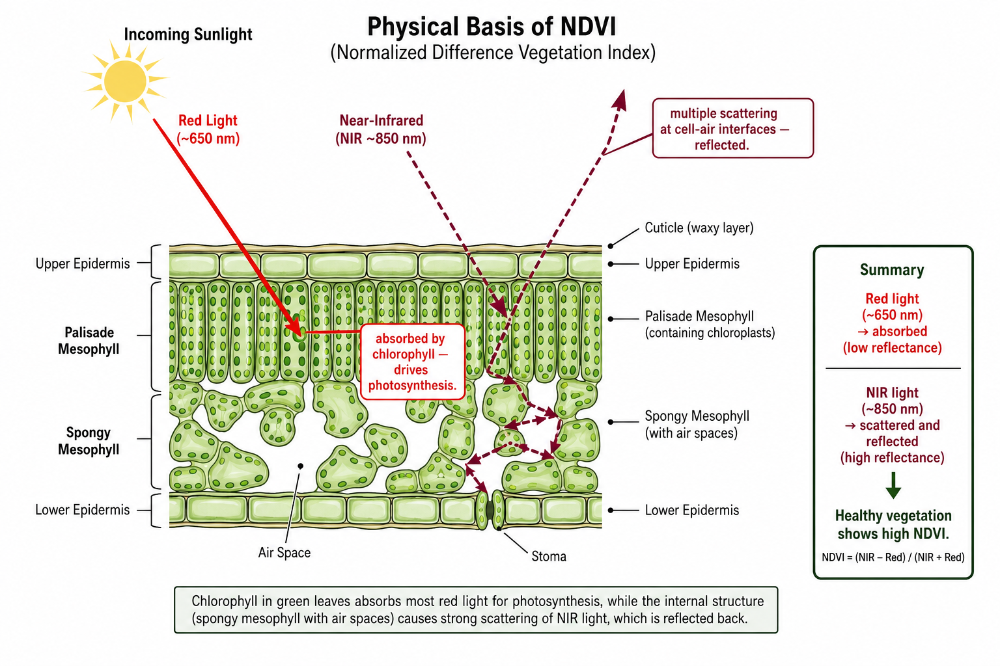

**Figure 2.** Leaf cross-section illustrating red-light absorption by chlorophyll in the palisade mesophyll versus near-infrared scattering at spongy mesophyll air-cell interfaces, the physical basis of the reflectance contrast measured by NDVI. *Illustration generated with an AI image tool, used only as a visual aid; it is not data or a result of this study.*

### 1.5 Research Questions and Hypotheses

**Table 1.** Research questions, hypotheses and where they are tested.

| Research question | Hypothesis | Section |
|---|---|---|
| RQ1 (main): In drought years, does SIF depart from its normal-year range before NDVI does? | H4: SIF's drought anomaly precedes NDVI's. | 3.9, 4.2 |
| RQ1b: Does SIF's normal post-peak decline begin before NDVI's? | H1: SIF's seasonal decline begins before NDVI's. | 3.4, 4.3–4.6 |
| RQ2: Does the SIF–NDVI lag differ between districts and with drought? | H2: the lag differs between districts. H3 (exploratory): drought widens the lag. | 3.8, 4.7 |
| RQ3: How do satellite drought signals time against the rainfall Trigger-1 and the 2015 and 2018 declarations? | — (descriptive) | 3.10, 4.9 |

H3 is exploratory because only two of the nine years (2015, 2018) meet the drought criterion (Section 3.5).

## 2. Study Area

The study covers all eight districts of Marathwada, Maharashtra — Chhatrapati Sambhajinagar (Aurangabad), Jalna, Parbhani, Hingoli, Nanded, Beed (called "Bid" in the FAO GAUL dataset used for boundary definition (FAO, 2015); see Section 3.2), Latur, and Dharashiv (Osmanabad) — chosen for its long history of agricultural drought. Agriculture is mostly rain-fed Kharif cropping (soybean, cotton, pulses, sorghum) during the June–September monsoon.

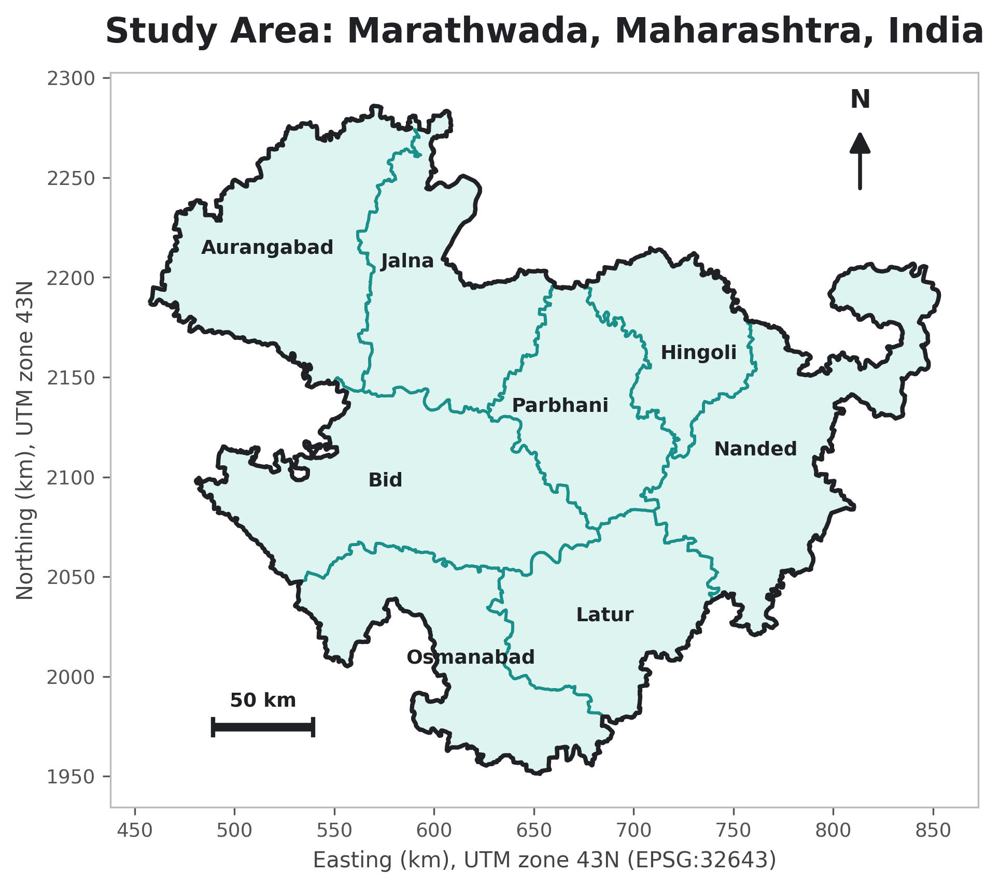

**Figure 3.** Study area: the eight districts of Marathwada, Maharashtra, India, with district boundaries and names.

## 3. Data and Methodology

### 3.1 Data Sources

All analyses cover the 1 June – 27 December window (day-of-year 153–361) of nine years, 2015–2023.

- **SIF (main):** GOSIF v2, a global 0.05°, 8-day solar-induced fluorescence product (Li & Xiao, 2019), distributed by the Global Ecology Group, University of New Hampshire.
- **SIF (independent check):** TROPOSIF v2.1 Level-2B daily soundings from Sentinel-5P TROPOMI (Guanter et al., 2021), for 2018–2020.
- **NDVI:** MODIS MOD13Q1 (Didan, 2021), 16-day, 250 m, via Google Earth Engine, including its per-pixel `DayOfYear` band (the day each pixel's value was observed).
- **Land cover:** MODIS MCD12Q1 (Friedl & Sulla-Menashe, 2022), IGBP classes 12 (cropland) and 14 (cropland/natural vegetation mosaic).
- **Precipitation:** CHIRPS daily rainfall (Funk et al., 2015), via Google Earth Engine: seasonal totals for 1981–2023 at region and district level, and daily series for the region (2001–2023) and districts (2015–2023). Every rainfall anomaly in this study comes from this one series.
- **Crop yields:** district-season-crop Area/Production/Yield statistics (Ministry of Agriculture & Farmers Welfare, 2024), Kharif season, 1997-98 to 2022-23.
- **Official declarations:** the 2015 Maharashtra drought declaration (reported 16 October 2015; India.com/ANI, 2015), the 2018 first-stage declaration of a drought-like situation (23 October 2018; Deccan Herald, 2018), and the 2018 final Kharif drought declaration (31 October 2018; Zee News, 2018; Economic and Political Weekly, 2018).

Three properties of this dataset combination shape how the results should be read. First, GOSIF is trained on OCO-2 SIF with MODIS reflectance (including EVI) and MERRA-2 reanalysis as predictors (Li & Xiao, 2019). Because MODIS reflectance also underlies MOD13Q1 NDVI, GOSIF and NDVI are not independent measurements; this is why the TROPOMI check (Section 3.11) was added. Second, GOSIF's 0.05° grid (about 5 km) is far coarser than MOD13Q1's 250 m, so every comparison is a regional- or district-scale signal, not a field-scale one. Third, class 14 is a cropland/natural-vegetation mosaic, so "cropland" here means a mixed agricultural landscape; classes 12 and 14 together cover about 96–97% of the study area's cells.

### 3.2 Boundary Definition and Verification

The study boundary comes from the FAO GAUL 2015 level-2 dataset, filtered to the eight Marathwada districts and merged into one polygon. Both the SIF clipping and the NDVI extraction use this polygon. Overlaying it on a clipped SIF raster confirmed that data survive only inside the district outlines (Figure 4).

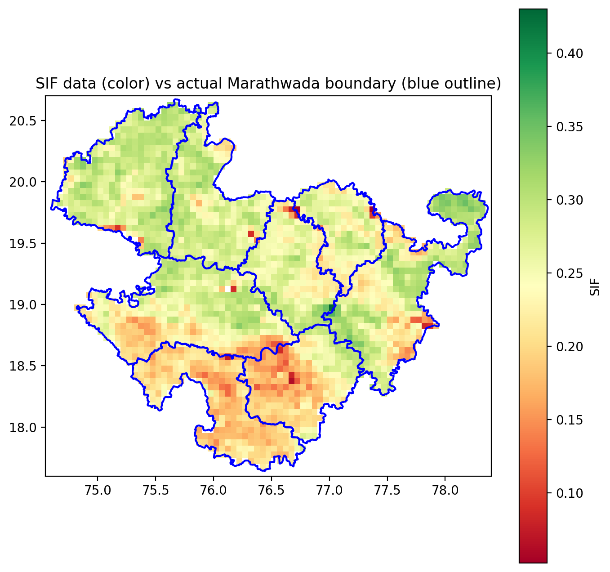

**Figure 4.** Verification of boundary masking: clipped SIF data (color) overlaid with the Marathwada district boundary (blue outline).

### 3.3 Processing Pipeline

**SIF.** GOSIF GeoTIFFs were clipped to the study boundary, scaled by GOSIF's 0.0001 factor, and masked for fill values (32767 water, 32766 snow/ice or barren). Each 0.05° cell was weighted by its cropland fraction — the share of MCD12Q1 pixels in classes 12 or 14 within that cell, computed in Earth Engine on the GOSIF grid. Each 8-day composite is dated at its centre (start day + 3.5).

**NDVI.** MOD13Q1 pixels were kept only where `SummaryQA` marks good or marginal quality and where MCD12Q1 classifies the pixel as cropland. Because a 16-day MOD13Q1 value can come from any day in its window, each composite was dated by the mean of its pixels' `DayOfYear` values rather than by its start date. Each year's NDVI series was normalised on its own observations and then linearly interpolated onto the SIF composite dates. During the monsoon many NDVI composites rest on few clear pixels (23 of 117 regional composites have under 25% of cropland pixels passing the quality screen); excluding such composites does not change the direction of any year's lag (Supplementary Figure S1).

### 3.4 Seasonal Lag Calculation

Each year's SIF and NDVI series was rescaled to 0–1 and the day-of-year on which each series first fell below a set of decline thresholds after its peak (0.9, 0.8, 0.7, 0.6, 0.5) was found by linear interpolation. The lag at each threshold is the NDVI crossing date minus the SIF crossing date (positive = SIF first), and a year's lag is the mean over the thresholds it reaches. Two rescalings were used:

- **Season range** (the original method): 0 at the year's seasonal minimum, 1 at its peak. The minimum is usually the pre-monsoon value in June.
- **Decline range**: 0 at the minimum *after* the peak, 1 at the peak, so each series is measured over its own decline.

The two give the same result if both series return to their pre-season level at the end of the season. If one does not, the season-range scaling makes that series cross every threshold later, because its post-season floor sits partway up the scale. An asymmetric double-logistic fit to each series, with the end-of-season inflection date as a third estimate, was also computed but is unstable with 8- and 16-day data and is reported only as a sensitivity check (Supplementary Figure S2).

### 3.5 Rainfall Anomaly and Drought Classification

Seasonal (June–December) CHIRPS totals for each year were compared against a 2001–2020 mean and standard deviation, giving a percentage anomaly and z-score. A year is a drought year when its z-score is below −0.5. June–September totals give the same two drought years. District-years were classified against each district's own 2001–2020 baseline (main) and, as a check, against the regional baseline. Because the 2001–2020 baseline contains six study years, the regional classification was repeated with three other baselines (2001–2014, 1981–2014, 1991–2020).

### 3.6 Cross-Correlation Lag

As a scale-free estimate, I used time-lagged cross-correlation over the post-peak decline window, starting at SIF's peak. Both series were interpolated to a daily grid, de-meaned, and cross-correlated at shifts from −N/4 to +N/4 days, N being the length of the decline window; the shift maximising the correlation between SIF(t) and NDVI(t + lag) is that year's estimate (positive = SIF first). Because correlation does not depend on scale, this estimate is not affected by the choice of normalisation.

### 3.7 Uncertainty

For cross-correlation, each year's observations were case-resampled 2,000 times and re-run through the same search; the 2.5th–97.5th percentiles give a 95% interval. For threshold-crossing, each series was smoothed (Savitzky–Golay, window 5, order 2), the residuals were resampled in moving blocks of three composites (to keep their autocorrelation) onto the smooth curve 2,000 times, and the lag recomputed; replicates were centred on the reported lag rather than on the smoothed curve's lag. A leave-one-observation-out jackknife gives a second view. The per-year draws were also combined into an interval for the drought-minus-normal difference that reflects measurement uncertainty only, not year-to-year variability.

### 3.8 District-Level Lag (H2, H3)

The same lags were computed for every district-year (8 × 9 = 72). Whether the lag differs between districts was tested with a two-way ANOVA (district and year effects) and a Friedman test across the nine years; drought and normal district-years were compared with Welch's t-test.

### 3.9 Drought-Specific Anomaly Signal (H4)

Seasonal lags say when each index starts its normal decline, not when it departs from normal. For each composite date, each year's SIF (and NDVI) value was standardised against the normal years at that date, excluding the year itself: z = (x − mean of normal years) / s.d. of normal years. A year's alarm date for a threshold (−0.5, −1, −1.5, −2, −3) is the first composite from 1 July at which z stays below the threshold for two consecutive composites. At the regional scale, z < −3 is the only threshold at which neither index raises an alarm in any normal year, so it is the main alarm threshold. The same procedure was applied to the 72 district-years: 15 drought and 57 normal against each district's own rainfall baseline (main), and 17 and 55 against the regional baseline (sensitivity). The separation of drought from normal district-years was also summarised date by date with the area under the ROC curve (AUC). District-years share each year's weather, so the AUCs are descriptive.

### 3.10 Rainfall Trigger and Declaration Dates (RQ3)

India's Manual for Drought Management (Ministry of Agriculture & Farmers Welfare, 2016a) starts drought assessment with a rainfall-based Trigger-1 built on rainfall deviation and dry spells. I approximated it as the first day after 1 July on which cumulative rainfall since 1 June is more than 25% below the 2001–2020 normal for that date and a dry spell (consecutive days below 2.5 mm) of at least 21 days has occurred, with dry spells counted only between 1 July and 30 September. Variants (deficit > 20% or > 30%, dry day < 1 mm, deficit alone, dry spell alone, and dry spells counted to December) were also run. The state applies the trigger at taluka level, and averaging rain over a district rarely leaves a 21-day spell, so this region- and district-level version is an approximation. Satellite alarm dates were compared against this trigger date and against the three declaration dates.

### 3.11 Independent Check with TROPOMI SIF

TROPOSIF soundings over Marathwada (1 June – 27 December, 2018–2020) were kept where cloud fraction < 0.2, solar zenith angle < 70° and the product's land-cover flag is cropland (12 or 14), and averaged into 8-day composites aligned with GOSIF's. The main variable is SIF_Corr_743 (Guanter et al., 2021); three variants were also run (cloud fraction < 0.5, all land cover, uncorrected SIF_743). The seasonal lag against NDVI was computed under both rescalings.

### 3.12 Method Dependence

The regional lag was recomputed under 40 combinations: SIF cropland-weighted or unweighted; NDVI timed by observation date or by compositing window; raw or smoothed series; and lag metric mean-threshold, 0.9, 0.7, 0.5, or cross-correlation (all with season-range scaling). For each combination I recorded whether SIF leads in all nine years, whether drought years have a smaller mean lag than normal years, and whether 2018 has the smallest lag.

### 3.13 Spatial Autocorrelation and Crop-Yield Check

Moran's I was computed each year for district SIF and rainfall anomaly with Queen-contiguity weights (9,999 permutations). For the yield check, every district-crop pair with at least 10 of the 26 Kharif seasons was converted to yield z-scores against its own mean and standard deviation and averaged into a Yield Anomaly Index per district-year and per region-year (n = 8 region-years, as the yield series ends in 2022-23).

## 4. Results

### 4.1 Rainfall and Drought Years

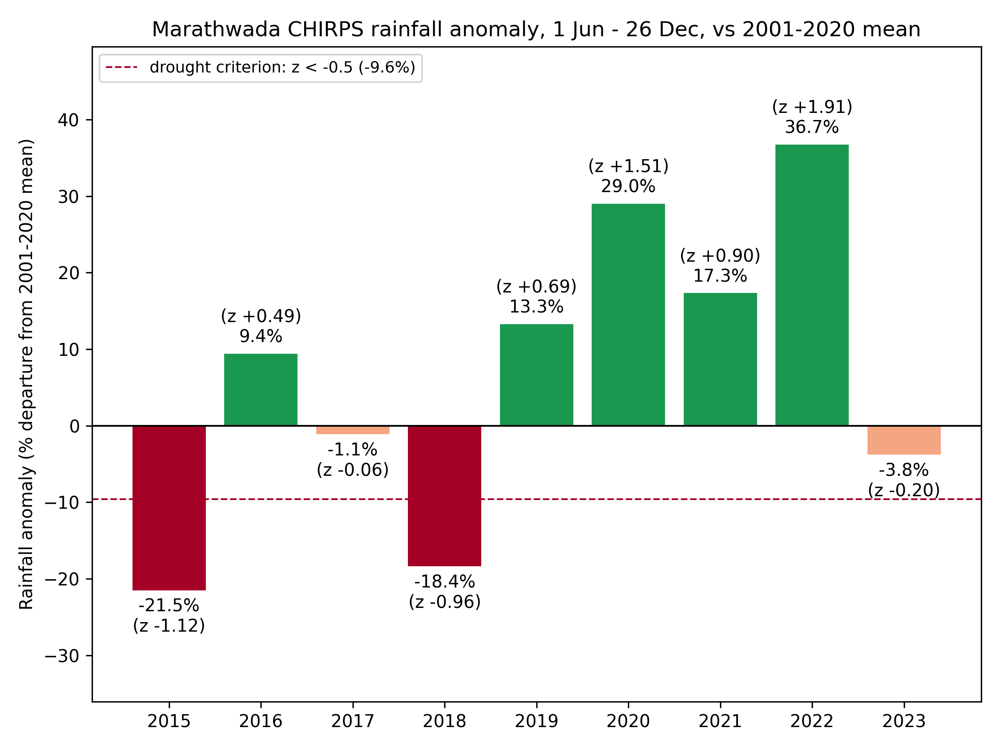

**Figure 5.** Regional June–December rainfall anomaly (% departure from the 2001–2020 mean), 2015–2023, with z-scores; dark red = drought years (z < −0.5).

Against a 2001–2020 mean of 826.8 mm (σ = 158.9 mm), the nine years came in at 649.0 mm in 2015 (−21.5%, z = −1.12); 904.7 mm in 2016 (+9.4%, z = 0.49); 817.4 mm in 2017 (−1.1%, z = −0.06); 674.9 mm in 2018 (−18.4%, z = −0.96); 936.3 mm in 2019 (+13.3%, z = 0.69); 1066.5 mm in 2020 (+29.0%, z = 1.51); 970.0 mm in 2021 (+17.3%, z = 0.90); 1130.3 mm in 2022 (+36.7%, z = 1.91, the wettest season since 1981); and 795.3 mm in 2023 (−3.8%, z = −0.20). Only 2015 and 2018 meet the drought criterion, under all four baselines and for every cut-off from −0.3 to −0.75. 2023 is a borderline case: its seasonal total is near normal, but August had 51 mm (z = −2.52), and Maharashtra declared drought in 40 talukas on 31 October 2023 (Morung Express/IANS, 2023). Under the same criterion, 2001, 2002, 2003, 2004 and 2014 would also be drought years, so extending the series before 2015 would add drought cases.

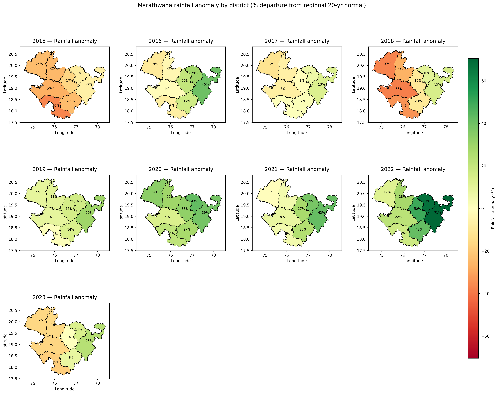

**Figure 6.** Rainfall anomaly by district (% departure from the regional 2001–2020 mean), 2015–2023.

The deficit was not spatially uniform. In 2018, Bid (−38.0%), Aurangabad (−37.3%) and Osmanabad (−33.9%) took the largest deficits while Hingoli (+10.2%) and Nanded (+14.6%) had surpluses; in 2015, Osmanabad (−36.4%) had the largest deficit and Hingoli (−8.0%) and Nanded (−7.1%) the mildest. Against each district's own baseline, 15 district-years are drought years: all eight districts in 2015, six in 2018 (all but Hingoli and Nanded) and Jalna in 2023.

### 4.2 Is There a Drought-Specific SIF Advantage? (H4)

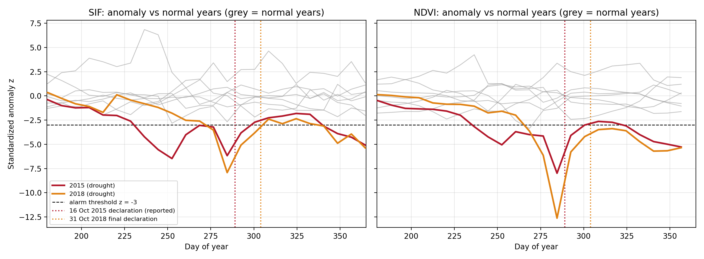

**Figure 7.** Standardised SIF and NDVI anomalies relative to normal years, by composite date; 2015 red, 2018 orange, normal years grey. The dashed line marks the alarm threshold z = −3 and the vertical line the 2015 declaration.

At the regional scale, at z < −3, SIF and NDVI both raised the 2015 alarm on 24 August; in 2018 NDVI did so on 25 September and SIF on 3 October, eight days later. At z < −1, SIF came first in both drought years (by 8 days in 2015 and 32 in 2018), but at that threshold each index also raised alarms in five of the seven normal years, so it does not separate drought from normal seasons. Both indices reached their deepest anomaly in 2018 on the same composite (11 October), NDVI more strongly (z = −12.6 vs −7.9).

**Table 2.** Drought alarms in district-years, own-district rainfall baseline (15 drought, 57 normal district-years).

| Threshold | Drought flagged, SIF | Drought flagged, NDVI | False alarms, SIF | False alarms, NDVI | Both flagged | SIF earlier | Same date | NDVI earlier |
|---|---|---|---|---|---|---|---|---|
| z < −1.5 | 15 | 15 | 22 | 24 | 15 | 1 | 1 | 13 |
| z < −2 | 14 | 15 | 11 | 12 | 14 | 2 | 2 | 10 |
| z < −3 | 12 | 13 | 2 | 4 | 12 | 1 | 6 | 5 |

At the main threshold the two indices most often raised the alarm on the same composite, and where they differed NDVI was usually first; at looser thresholds NDVI was first in most drought district-years (Table 2). SIF had slightly fewer false alarms. With the regional baseline instead (17 drought district-years), the picture is the same: at z < −3 both flag 12, NDVI is earlier in 7, the same in 4 and later in 1. The date-by-date AUC shows both indices separating drought from normal district-years from 23 July (AUC ≥ 0.75; SIF 0.80, NDVI 0.76). SIF's AUC is slightly higher from mid-July to 8 August, and NDVI's is higher from 24 August to 19 October (0.78–0.96 vs 0.76–0.94).

H4 is therefore not supported: in this dataset SIF does not depart from its normal-year range earlier than NDVI. Its only consistent advantage is a slightly higher separation in July and early August and fewer false alarms, neither large enough to change the timing of a drought alarm.

### 4.3 Seasonal SIF–NDVI Trajectories

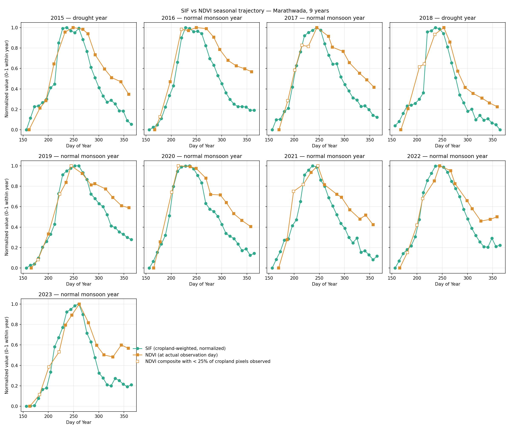

**Figure 8.** Normalised cropland-weighted SIF and NDVI (at observation day) seasonal trajectories, Marathwada, 2015–2023 (season-range scaling). Open squares mark NDVI composites in which fewer than 25% of cropland pixels passed the quality screen.

Under season-range scaling, SIF's post-peak decline appears to get under way ahead of NDVI's in all nine years, with NDVI holding near its peak for longer. Figure 8 also shows why the scaling matters: by late December SIF is back near its June level (0.00–0.28 on the season scale), but NDVI is not (0.23–0.59). Post-monsoon NDVI stays well above its pre-monsoon level, likely because of residual vegetation, Rabi sowing and weeds on fallow land.

### 4.4 Threshold-Crossing Lag and Its Dependence on Normalisation

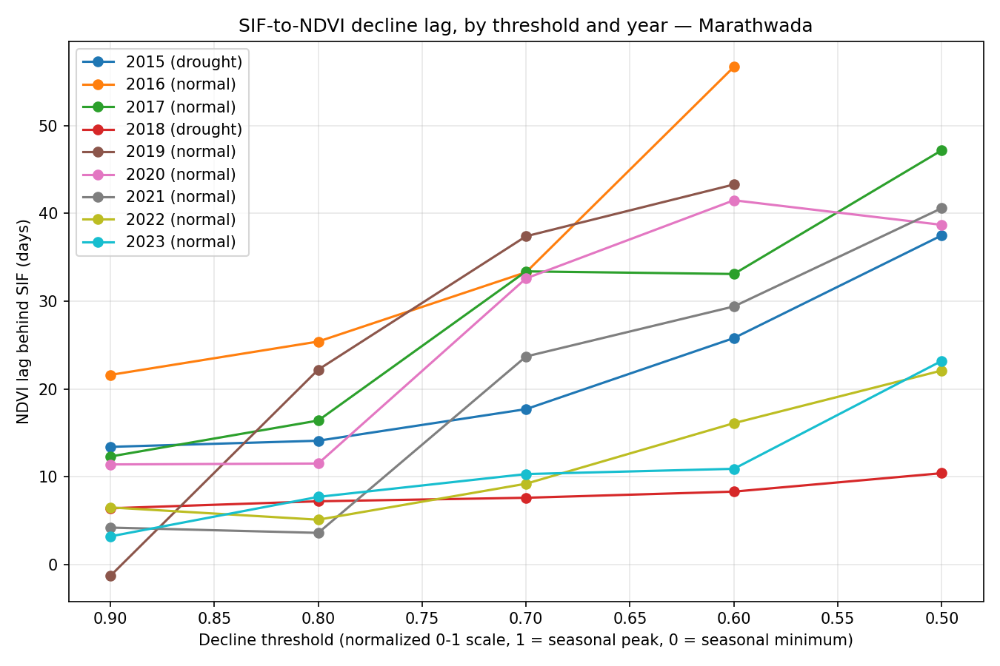

**Figure 9.** SIF-to-NDVI decline lag (days), by decline threshold and year (season-range scaling).

Under season-range scaling, the lag was 21.7 days (2015), 34.2 (2016), 28.5 (2017), 8.0 (2018), 25.4 (2019), 27.1 (2020), 20.3 (2021), 11.8 (2022) and 11.1 (2023), all positive, and the lag grows with depth of decline (Figure 9). The moving-block bootstrap puts every year above zero (95% intervals: 2015 [16.3, 30.4]; 2016 [12.5, 39.6]; 2017 [17.5, 32.5]; 2018 [2.8, 16.1]; 2019 [8.9, 33.0]; 2020 [18.6, 34.4]; 2021 [4.0, 25.2]; 2022 [5.3, 14.9]; 2023 [7.6, 16.6]); 8 of the 36 pairs of years have non-overlapping intervals.

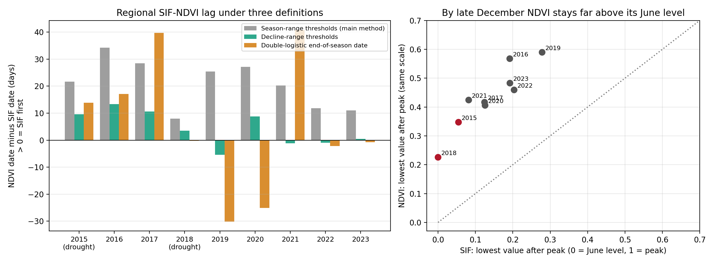

**Figure 10.** Regional SIF–NDVI lag by year under season-range scaling, decline-range scaling, and the double-logistic end-of-season date.

That lead rests on the scaling. When each series is scaled from its peak to its own post-peak minimum, the lag becomes 9.6 (2015), 13.4 (2016), 10.6 (2017), 3.5 (2018), −5.5 (2019), 8.8 (2020), −1.2 (2021), −1.0 (2022) and 0.4 (2023) days: SIF is first in six years by 0.4–13.4 days, and NDVI is first by 1–6 days in 2019, 2021 and 2022 (Figure 10). The double-logistic end-of-season date gives lags from −30 to +41 days with no consistent sign, and its fits are unstable (Supplementary Figure S2). How far each year's lead shrinks broadly follows how much higher NDVI's post-season floor sits than SIF's: across the nine years, that gap (on the season scale) correlates with the difference between the two lags at r = 0.67.

**Table 3.** Regional results by year and method.

| Year | Drought? | Season-range lag (days) | Block-bootstrap 95% interval | Decline-range lag (days) | Cross-correlation lag (days) | Cross-correlation 95% interval |
|---|---|---|---|---|---|---|
| 2015 | Yes | +21.7 | [16.3, 30.4] | +9.6 | +10 | [6, 13] |
| 2016 | No | +34.2 | [12.5, 39.6] | +13.4 | +12 | [8, 15] |
| 2017 | No | +28.5 | [17.5, 32.5] | +10.6 | +14 | [−20, 28] |
| 2018 | Yes | +8.0 | [2.8, 16.1] | +3.5 | +4 | [0, 6] |
| 2019 | No | +25.4 | [8.9, 33.0] | −5.5 | 0 | [−20, 24] |
| 2020 | No | +27.1 | [18.6, 34.4] | +8.8 | +9 | [−28, 28] |
| 2021 | No | +20.3 | [4.0, 25.2] | −1.2 | +20 | [−4, 30] |
| 2022 | No | +11.8 | [5.3, 14.9] | −1.0 | −1 | [−5, 3] |
| 2023 | No | +11.1 | [7.6, 16.6] | +0.4 | −3 | [−10, 0] |

### 4.5 Cross-Correlation and Its Uncertainty

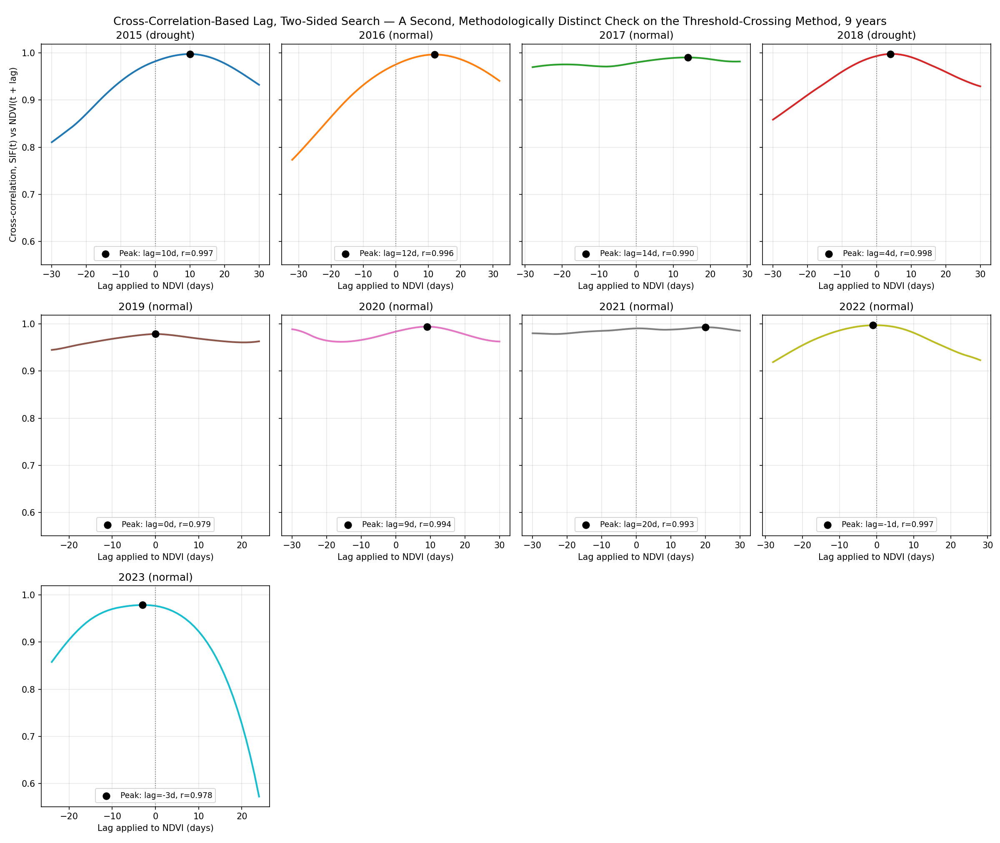

**Figure 11.** Cross-correlation between SIF and NDVI as a function of the lag applied to NDVI, by year. Black markers show the correlation-maximising lag; a negative lag means NDVI leads SIF.

Cross-correlation does not depend on scaling. The correlation-maximising shift was 10 days (2015), 12 (2016), 14 (2017), 4 (2018), 0 (2019), 9 (2020), 20 (2021), −1 (2022) and −3 (2023), with peak correlations of 0.979–0.998. The correlation curves are flat — the correlation at zero shift is already 0.975–0.993 — so the shift is poorly determined.

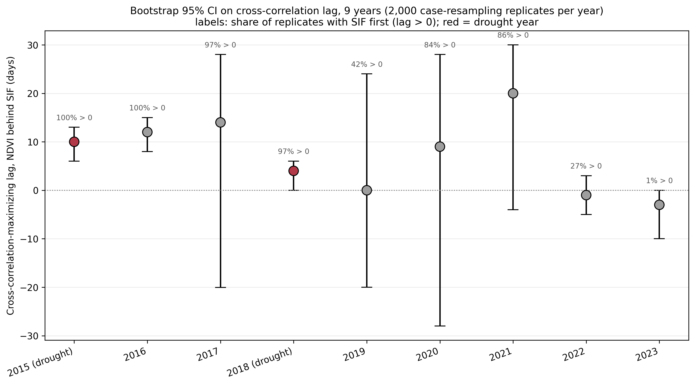

**Figure 12.** Cross-correlation lag point estimates with 95% bootstrap intervals (case resampling, 2,000 replicates per year), labelled with the percentage of replicates showing a SIF lead.

The 95% intervals exclude zero on the SIF-lead side only in 2015 and 2016; 2018 sits on zero, and 2023 leans the other way (Table 3). Cross-correlation and the decline-range lag broadly agree: both put 2015 and 2016 among the clearest SIF leads and find no lead in 2019, 2022 and 2023. The two scale-independent or scale-matched methods therefore point to a small, year-dependent SIF lead, not the consistent three-week lead of the season-range method.

### 4.6 Independent Check with TROPOMI SIF

**Table 4.** TROPOMI (TROPOSIF v2.1) versus GOSIF, 2018–2020. Lags are NDVI crossing minus SIF crossing (days).

| Year | Composites | r (TROPOMI vs GOSIF) | Peak DOY TROPOMI | Peak DOY GOSIF | Season-range lag, TROPOMI | Season-range lag, GOSIF | Decline-range lag, TROPOMI | Decline-range lag, GOSIF |
|---|---|---|---|---|---|---|---|---|
| 2018 | 26 | 0.91 | 244.5 | 236.5 | 12.8 | 8.0 | 10.4 | 3.5 |
| 2019 | 26 | 0.97 | 252.5 | 260.5 | 43.8 | 25.4 | 10.3 | −5.5 |
| 2020 | 26 | 0.97 | 212.5 | 236.5 | 45.3 | 27.1 | 27.7 | 8.8 |

Of 630,091 soundings inside Marathwada on 540 days, 53% passed the cloud filter. TROPOMI reproduces GOSIF's seasonal trajectory closely (r = 0.91–0.97) and puts SIF's decline before NDVI's in all three years under both scalings, though by different amounts; the four TROPOMI variants agree (season-range lags 10.8–45.9 days, none negative). TROPOMI peaks earlier than GOSIF in 2020 and its lead is larger, so the size of the lead does not carry over between products. The 2018 deficit relative to 2019–2020 appears in both products (correlation of the two ratio series, August–October, r = 0.91). With only two normal TROPOMI years, a TROPOMI version of the H4 anomaly test is not yet meaningful.

### 4.7 Method Dependence and District-Level Lags (H2, H3)

Across the 40 combinations of Section 3.12 (all season-range), the claim that SIF leads in all nine years holds in all 8 mean-threshold combinations, in 4 of 8 at the 0.9 threshold, and in none of the 8 cross-correlation combinations. Using unweighted SIF and window-paired NDVI changes individual years' mean lag by −2.5 to +2.6 days; cropland weighting changes lags by at most 0.2 days. These choices matter far less than the scaling.

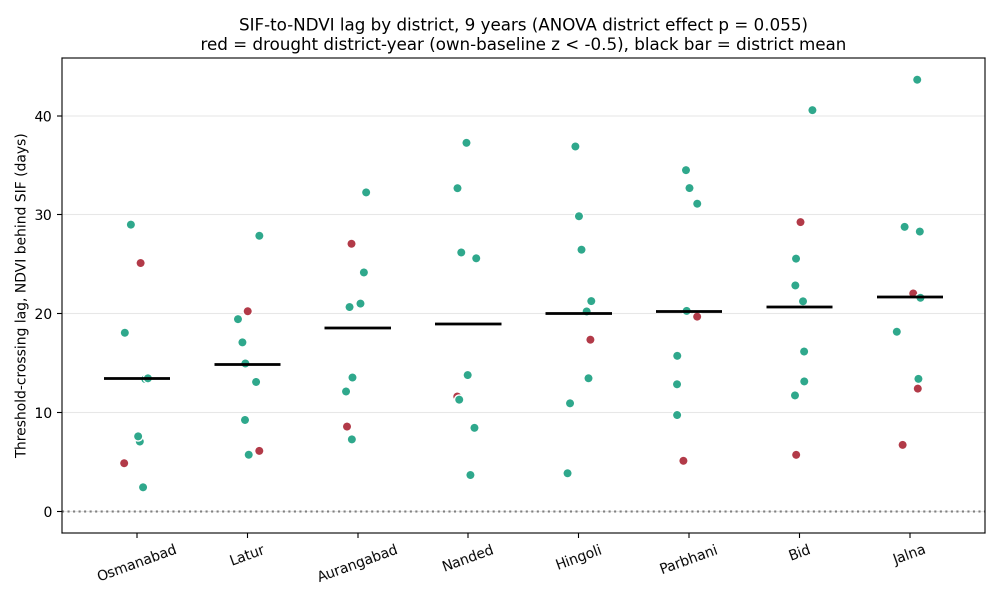

**Figure 13.** Season-range SIF–NDVI lag by district and year.

Under season-range scaling, SIF's decline came first in all 72 district-years (median 17.7 days, range 2.4–43.6), and the district effect is significant in the Friedman test (χ² = 14.5, p = 0.043) and borderline in the two-way ANOVA (p = 0.055). Under decline-range scaling, SIF is first in 52 of 72 district-years (median 2.3 days, range −8.1 to 19.9), district means range only from 2.9 to 5.6 days, and the Friedman test finds no district effect (p = 0.97). H2 is therefore not supported: the apparent district differences come from differences in how far NDVI stays up after the season.

H3 is not supported either. Regionally, drought years had a smaller season-range lag than normal years (14.8 vs 22.6 days) and a slightly larger decline-range lag (6.5 vs 3.6 days); with two drought years neither difference is interpretable. The block-bootstrap drought-minus-normal difference for the season-range lag is −7.8 days with a measurement-only interval of [−9.9, +1.8]. At district level (own baseline), drought district-years average 14.8 vs 19.5 days (season range, Welch p = 0.080) and 5.8 vs 3.4 days (decline range, p = 0.13).

### 4.8 Spatial SIF Pattern and Spatial Autocorrelation

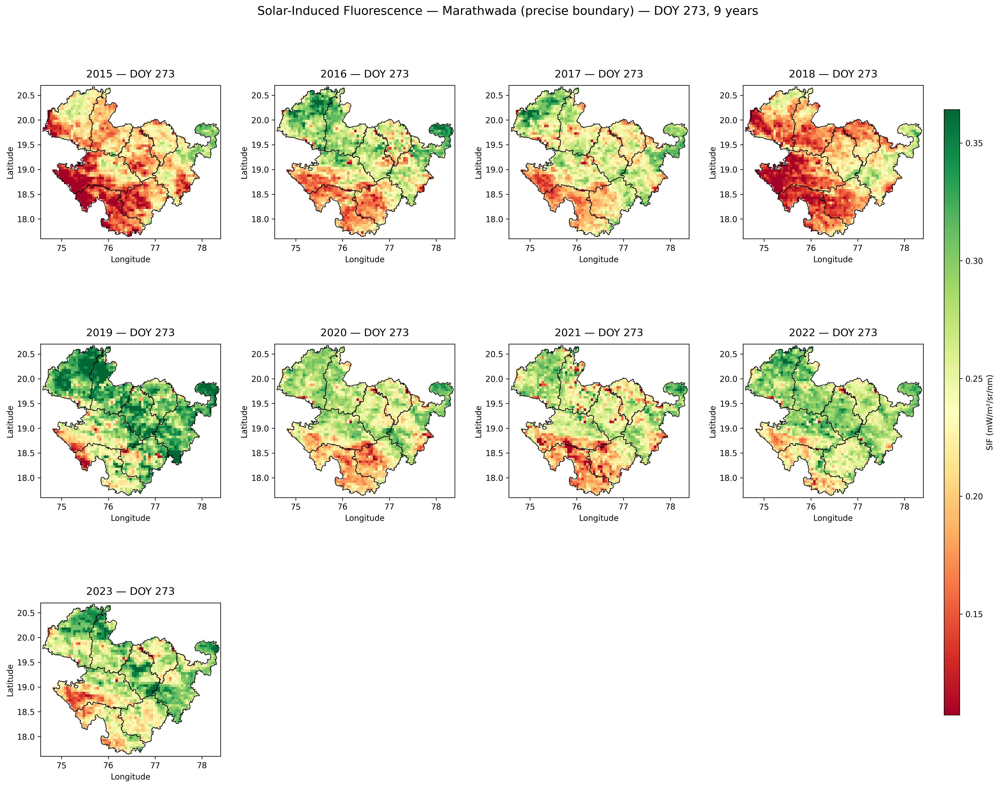

**Figure 14.** Spatial SIF distribution, day-of-year 273, 2015–2023.

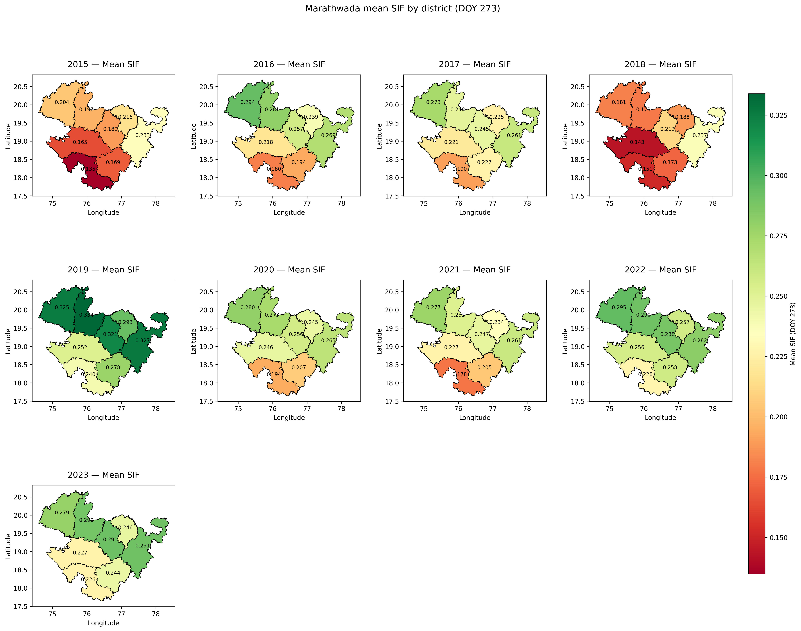

**Figure 15.** Mean SIF by district, day-of-year 273, 2015–2023.

Osmanabad has the lowest district SIF on day-of-year 273 in eight of nine years; in 2018 Bid (0.143) is lower than Osmanabad (0.151). The highest-SIF district varies: Aurangabad in five years, Nanded in two (2015, 2018), Jalna and Parbhani in one each.

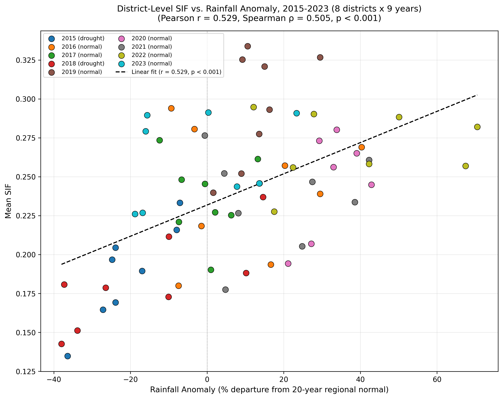

**Figure 16.** District-level SIF (day-of-year 273) against rainfall anomaly, 72 district-years.

District SIF and rainfall anomaly correlate across the 72 district-years (day-of-year 273: Pearson r = 0.53, Spearman ρ = 0.51, both p < 0.0001; p = 0.001 with standard errors clustered by year). Season-mean SIF correlates more strongly (r = 0.74), including within years (r = 0.66). With district and year fixed effects the relationship is not significant (p = 0.37 for season-mean SIF): SIF and rainfall move together across years and across districts, but a district's departure from its own average in a given year is not reliably tracked by SIF.

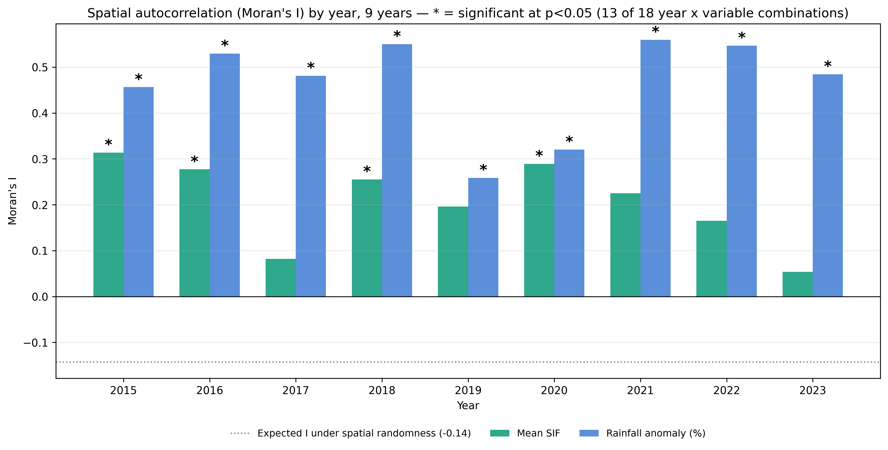

**Figure 17.** Moran's I for district SIF (day-of-year 273) and rainfall anomaly, by year (* = p < 0.05).

Rainfall anomaly is spatially clustered in all nine years (Moran's I 0.26–0.56). Day-of-year-273 SIF is clustered in four years, season-mean SIF in all nine (I = 0.29–0.54). District observations are therefore not independent, which is why the clustered and fixed-effects versions above are the ones to rely on.

### 4.9 Satellite Signals, the Rainfall Trigger and Official Declarations (RQ3)

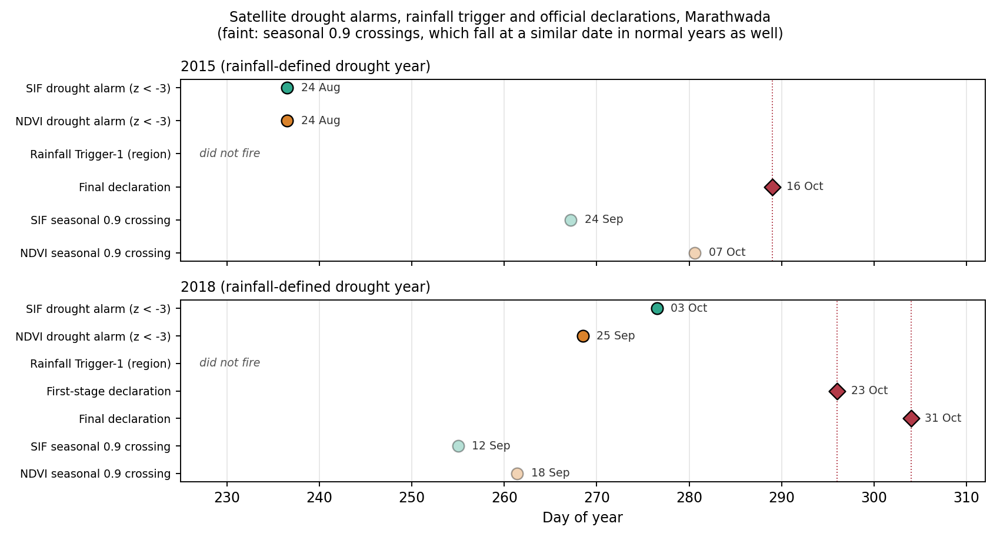

**Figure 18.** Timeline of the 2015 and 2018 seasons: SIF and NDVI drought alarms (z < −3), the regional Trigger-1 approximation (did not fire), the declaration dates, and, faintly, the seasonal 0.9 crossings.

**Rainfall trigger.** With dry spells counted inside the monsoon, the Trigger-1 approximation never fired for the region as a whole. At district level it fired in 2 of the 15 drought district-years — Aurangabad 2018 (3 October) and Bid 2018 (17 September) — and in one normal district-year (Bid 2017, 10 August). In Aurangabad the NDVI alarm came 23.5 days and the SIF alarm 15.5 days before the trigger; in Bid 2018 both alarms came 0.5 days after it. The deficit criterion alone fires in 10 drought and 18 normal district-years and for the region in 2015, 2017, 2019 and 2023; the dry-spell criterion alone fires in 2 drought and 5 normal district-years. Counting dry spells to December, as an earlier version of this analysis did, makes the trigger fire in 4 drought district-years, mostly after the monsoon. As approximated here, the rainfall trigger rarely fires on averaged rainfall, and its deficit component alone does not separate drought from normal years.

**Declarations.** The drought alarms (z < −3) came 52.5 days before the 2015 declaration (16 October) for both indices; 27.5 (SIF) and 35.5 (NDVI) days before the 2018 final declaration (31 October); and 19.5 and 27.5 days before the 2018 first-stage declaration (23 October). The seasonal 0.9 crossings (Figure 18, faint) happen at a similar time in every year, so they mark the normal start of the decline, not drought.

Under the Manual for Drought Management, the declaration follows a sequence of triggers that ends in field verification of crop damage (Ministry of Agriculture & Farmers Welfare, 2016a), so a satellite signal will precede it almost by construction. The more meaningful comparison is with the rainfall trigger, and there NDVI's anomaly was at least as early as SIF's in both cases where the trigger fired.

### 4.10 Crop-Yield Check

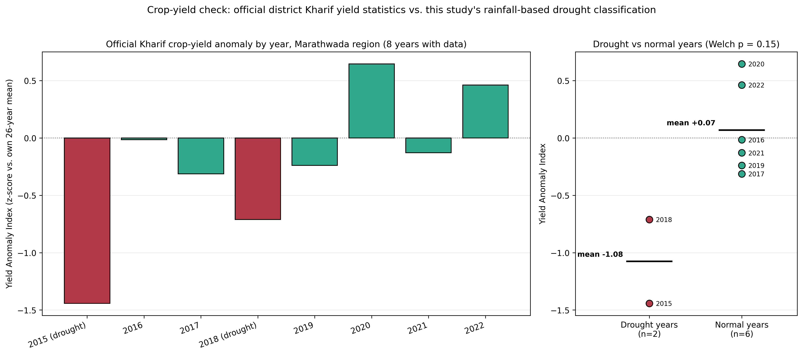

**Figure 19.** Marathwada Kharif Yield Anomaly Index by year (points per year and group means), with rainfall anomaly.

The Yield Anomaly Index (127 district-crop pairs, 16 crops) tracks rainfall closely (r = 0.93, p = 0.0009, n = 8). Its correlation with season-mean (June–December) regional SIF is r = 0.88 (p = 0.004), and r = 0.80–0.85 (p = 0.007–0.017) under versions without zero yields and outliers, area-weighted, detrended and major-crops-only; with day-of-year-273 SIF alone it is r = 0.67 (p = 0.071). At district level, with district and year fixed effects, the yield index remains associated with season-mean SIF (p = 0.015–0.040 across versions). The two drought years had a mean index of −1.08 against +0.07 for the six normal years with data (Welch p = 0.15): lower harvests in the expected direction, but not significant with two drought years. This supports the drought classification; it says nothing about within-season timing.

## 5. Discussion

The main result is negative for the question this study set out to answer. When each index is compared with its own normal-year behaviour, GOSIF SIF does not flag drought earlier than NDVI in Marathwada: at the regional scale the alarms coincide in 2015 and NDVI is first in 2018, and across drought district-years the two most often coincide at the strictest threshold, with NDVI earlier at looser ones. H4 is not supported.

The secondary result — SIF's seasonal decline starting before NDVI's — turns out to depend on how a decline is measured. Scaled over the whole season, SIF crosses every threshold first, in every year and every district-year. But NDVI in this region does not return to its pre-monsoon level after the season, while SIF largely does. On the season scale NDVI's decline is therefore measured against a floor it never reaches, and it crosses each threshold later. Scaled over each series' own decline, the lead shrinks to 0–13 days and disappears in three years; the district differences disappear with it; and cross-correlation, which does not depend on scaling, agrees with the smaller estimate. The TROPOMI check does show SIF first in all three of its years under both scalings, so a small SIF lead may exist, but the robust three-week lead of the season-range method is mostly a property of NDVI's post-season baseline.

Both results are consistent with a reading in which, at 5 km and 8- to 16-day resolution, GOSIF behaves largely as a greenness and absorbed-light signal. GOSIF is predicted from MODIS EVI and reanalysis weather (Li & Xiao, 2019), and canopy SIF is dominated by APAR and structure (Dechant et al., 2020), so it would be surprising if it carried an independent early stress signal. The limited TROPOMI years, and the vegetation-index comparison prepared for this study (NDVI vs EVI vs NIRv; not yet run), are the obvious next tests.

For policy, the relevant comparison is with the rainfall trigger, not the declaration. On averaged rainfall the trigger rarely fires, and its deficit component fires as often in normal years as in drought years. Satellite vegetation anomalies were available about as early as the trigger where it fired. That is an argument for vegetation anomalies as an input to drought monitoring; this study gives no reason to prefer GOSIF SIF over the NDVI already in use.

## 6. Limitations

- **Two drought years.** Only 2015 and 2018 meet the regional drought criterion; every drought-versus-normal comparison at regional scale rests on them. Extending the record to 2001–2014 would add at least five drought years under the same criterion.
- **Normalisation dependence.** The seasonal lead depends on how each series is scaled (Section 4.4). The double-logistic fits that could provide a third, model-based estimate are unstable with the available sampling.
- **Lag size and sampling.** GOSIF is 8-day and MOD13Q1 16-day; decline-range leads are mostly smaller than the NDVI sampling interval.
- **NDVI coverage.** Many monsoon NDVI composites rest on few clear pixels. The lag direction is robust to excluding them (Supplementary Figure S1), but the timing of individual composites is uncertain.
- **Post-hoc thresholds.** The decline thresholds, the drought cut-off (z < −0.5) and the alarm threshold (z < −3) were chosen in the course of this study. Sensitivity checks are reported, but the analysis is exploratory.
- **Retrospective measures.** Both lag measures need the whole season, and the anomaly alarms use a normal-year reference that includes later years; they are retrospective timing comparisons, not an operational early-warning procedure.
- **GOSIF–MODIS dependence.** GOSIF uses MODIS reflectance as a predictor. TROPOMI removes this only for 2018–2020, with one drought year and two normal years.
- **Spatial scale.** All results are regional or district averages at about 5 km over a mixed cropland mask; they do not describe individual crops or fields.
- **Rainfall trigger approximation.** The Trigger-1 used here is computed on averaged rainfall, not per taluka or per pixel; a pixel-level version has been prepared but not yet run.
- **Declarations.** Only three declaration dates were found; the 2015 date is the date it was reported. The declaration process ends after field verification, so satellite signals precede it almost by construction.
- **Yield data.** Yield is one end-of-season number per district-crop, ends in 2022-23, and includes some crops grown partly outside the Kharif season.

## 7. Conclusion

Across nine Kharif seasons in Marathwada, GOSIF SIF did not flag agricultural drought earlier than NDVI. Compared with their own normal-year behaviour, the two indices raised the alarm on the same date in 2015, NDVI was first in 2018, and across drought district-years they most often coincided, with NDVI earlier at looser thresholds.

SIF's normal seasonal decline appears to start well before NDVI's when each curve is scaled over the whole season, but most of that lead comes from NDVI not returning to its pre-season level after the monsoon. Measured over each series' own decline, or by cross-correlation, the lead is small, varies between years, and is absent in about a third of them; an independent TROPOMI retrieval suggests a small lead may remain.

In this region and dataset, SIF is not an earlier drought alarm than NDVI. Satellite vegetation anomalies may add lead time to a rainfall-led trigger, which rarely fired at these scales, but this study gives no evidence that SIF would add more than NDVI already does. Testing that properly needs more drought years, direct SIF retrievals over more seasons, and a comparison with other reflectance indices.

## Declarations

**Ethics statement:** Not applicable. This study did not involve human participants, animals, or personal data of any kind.

**Competing interests:** I declare no competing interests.

**Funding:** This research received no external funding. I covered all costs myself.

**Data availability:** Processed data and analysis code for this study are available at [https://github.com/sakshimaske303-commits/GREEN_ALIBI](https://github.com/sakshimaske303-commits/GREEN_ALIBI); the full pipeline runs from `run_all.py`. An interactive dashboard presenting this study's results is available at [https://greenalibi-bzs2wvod5fflqh7dfe2cf4.streamlit.app](https://greenalibi-bzs2wvod5fflqh7dfe2cf4.streamlit.app). The raw satellite and rainfall datasets (GOSIF, TROPOSIF, MODIS, CHIRPS, FAO GAUL) are publicly available from their original providers, cited below.

**CRediT author statement:** Sakshi D. Maske: Conceptualization, Methodology, Software, Validation, Formal analysis, Investigation, Data curation, Writing - original draft, Writing - review and editing, Visualization.

**Acknowledgements:** None.

## Revision Note

This version corrects five data-handling errors present in the first preprint: NDVI dates one day early combined with nearest-date matching (which shortened every lag by about eight days); a cross-correlation search that could not return negative lags; a half-pixel longitude offset in the 2021 and 2022 GOSIF files; a district-name mismatch ("Beed" vs "Bid"); and two different rainfall sources used for different anomalies. Relative to the previous version it also: makes the drought-anomaly test (H4) the main question; adds the decline-range normalisation and double-logistic checks (Section 4.4), which change the interpretation of the seasonal lead and of H2; classifies district drought against each district's own rainfall baseline; counts dry spells for Trigger-1 only within the monsoon; uses a moving-block bootstrap centred on the reported lag; and adds the NDVI coverage check. GA_Development_Log.md records each change.

## Supplementary Figures

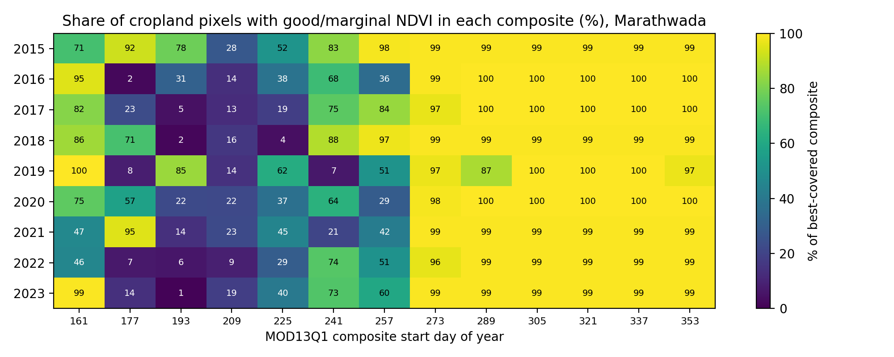

**Figure S1.** Share of cropland NDVI pixels passing the quality screen in each regional composite, and the regional season-range lag when composites below 10%, 25% or 50% coverage are excluded.

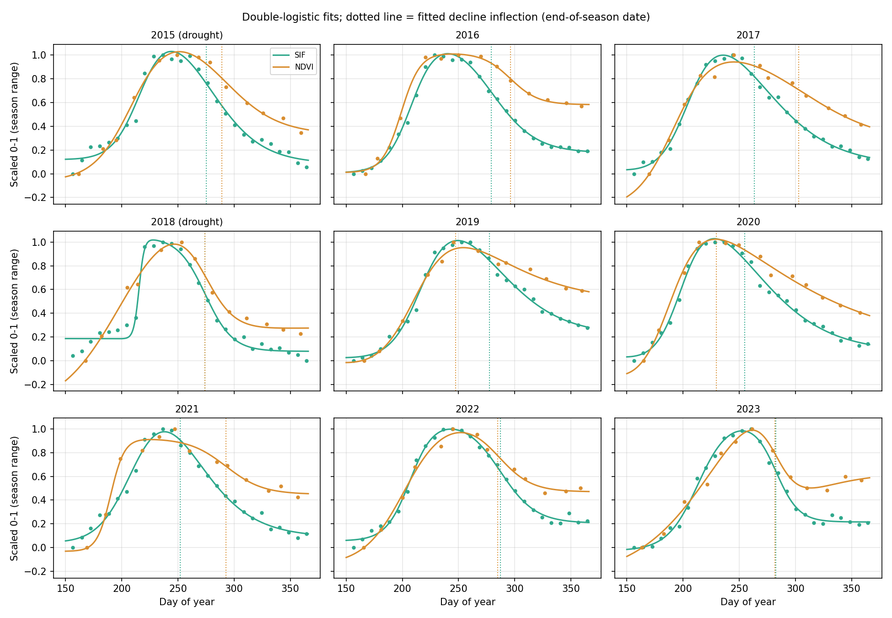

**Figure S2.** Asymmetric double-logistic fits to the regional SIF and NDVI series, by year, with the fitted end-of-season dates.

## References

Badgley, G., Field, C. B., & Berry, J. A. (2017). Canopy near-infrared reflectance and terrestrial photosynthesis. *Science Advances*, 3(3), e1602244. [https://doi.org/10.1126/sciadv.1602244](https://doi.org/10.1126/sciadv.1602244)

Deccan Herald. (2018, October 23). *Drought-like situation declared in 180 tehsils*. [https://www.deccanherald.com/india/drought-situation-declared-180-699467.html](https://www.deccanherald.com/india/drought-situation-declared-180-699467.html)

Dechant, B., Ryu, Y., Badgley, G., Zeng, Y., Berry, J. A., Zhang, Y., Goulas, Y., Li, Z., Zhang, Q., Kang, M., Li, J., & Moya, I. (2020). Canopy structure explains the relationship between photosynthesis and sun-induced chlorophyll fluorescence in crops. *Remote Sensing of Environment*, 241, 111733. [https://doi.org/10.1016/j.rse.2020.111733](https://doi.org/10.1016/j.rse.2020.111733)

Didan, K. (2021). *MODIS/Terra Vegetation Indices 16-Day L3 Global 250m SIN Grid V061* [Data set]. NASA EOSDIS Land Processes Distributed Active Archive Center. [https://doi.org/10.5067/MODIS/MOD13Q1.061](https://doi.org/10.5067/MODIS/MOD13Q1.061)

Down To Earth. (2025). *When crop insurance fails farmers: Why India's PMFBY scheme needs urgent reform*. [https://www.downtoearth.org.in/agriculture/when-crop-insurance-fails-farmers-pmfby-needs-a-rethink](https://www.downtoearth.org.in/agriculture/when-crop-insurance-fails-farmers-pmfby-needs-a-rethink)

Economic and Political Weekly. (2018). Drought in Maharashtra [Editorial]. *Economic and Political Weekly*, 53(48). [https://www.epw.in/journal/2018/48/editorials/drought-maharashtra.html](https://www.epw.in/journal/2018/48/editorials/drought-maharashtra.html)

Food and Agriculture Organization of the United Nations (FAO). (2015). *FAO GAUL (Global Administrative Unit Layers): Global Administrative Unit Layers 2015, Level 2* [Data set]. Google Earth Engine Data Catalog. [https://developers.google.com/earth-engine/datasets/catalog/FAO_GAUL_2015_level2](https://developers.google.com/earth-engine/datasets/catalog/FAO_GAUL_2015_level2)

Friedl, M., & Sulla-Menashe, D. (2022). *MODIS/Terra+Aqua Land Cover Type Yearly L3 Global 500m SIN Grid V061* [Data set]. NASA EOSDIS Land Processes Distributed Active Archive Center. [https://doi.org/10.5067/MODIS/MCD12Q1.061](https://doi.org/10.5067/MODIS/MCD12Q1.061)

Funk, C., Peterson, P., Landsfeld, M., Pedreros, D., Verdin, J., Shukla, S., Husak, G., Rowland, J., Harrison, L., Hoell, A., & Michaelsen, J. (2015). The climate hazards infrared precipitation with stations—a new environmental record for monitoring extremes. *Scientific Data*, 2, Article 150066. [https://doi.org/10.1038/sdata.2015.66](https://doi.org/10.1038/sdata.2015.66)

Guanter, L., Bacour, C., Schneider, A., Aben, I., van Kempen, T. A., Maignan, F., Retscher, C., Köhler, P., Frankenberg, C., Joiner, J., & Zhang, Y. (2021). The TROPOSIF global sun-induced fluorescence dataset from the Sentinel-5P TROPOMI mission. *Earth System Science Data*, 13, 5423–5440. [https://doi.org/10.5194/essd-13-5423-2021](https://doi.org/10.5194/essd-13-5423-2021)

Huete, A., Didan, K., Miura, T., Rodriguez, E. P., Gao, X., & Ferreira, L. G. (2002). Overview of the radiometric and biophysical performance of the MODIS vegetation indices. *Remote Sensing of Environment*, 83(1–2), 195–213. [https://doi.org/10.1016/S0034-4257(02)00096-2](https://doi.org/10.1016/S0034-4257(02)00096-2)

India.com / ANI. (2015, October 16). *Maharashtra: Drought declared in 14,708 villages*. [https://www.india.com/news/india/maharashtra-drought-declared-in-14708-villages-state-government-waves-off-school-students-fees-637146/](https://www.india.com/news/india/maharashtra-drought-declared-in-14708-villages-state-government-waves-off-school-students-fees-637146/)

Jönsson, P., & Eklundh, L. (2004). TIMESAT—a program for analyzing time-series of satellite sensor data. *Computers & Geosciences*, 30(8), 833–845. [https://doi.org/10.1016/j.cageo.2004.05.006](https://doi.org/10.1016/j.cageo.2004.05.006)

Li, X., & Xiao, J. (2019). A global, 0.05-degree product of solar-induced chlorophyll fluorescence derived from OCO-2, MODIS, and reanalysis data. *Remote Sensing*, 11(5), 517. [https://doi.org/10.3390/rs11050517](https://doi.org/10.3390/rs11050517)

Ministry of Agriculture & Farmers Welfare, Government of India. (2016a). *Manual for Drought Management*. Department of Agriculture, Cooperation & Farmers Welfare, New Delhi.

Ministry of Agriculture & Farmers Welfare, Government of India. (2016b). *Pradhan Mantri Fasal Bima Yojana (PMFBY)*. Retrieved from [https://pmfby.gov.in](https://pmfby.gov.in)

Ministry of Agriculture & Farmers Welfare, Government of India. (2024). *Crop Wise Area Production Yield* [Data set]. India Data Portal. [https://indiadataportal.com/p/area-production-yield-apy](https://indiadataportal.com/p/area-production-yield-apy)

Mohammed, G. H., Colombo, R., Middleton, E. M., Rascher, U., van der Tol, C., Nedbal, L., Goulas, Y., Pérez-Priego, O., Damm, A., Meroni, M., Joiner, J., Cogliati, S., Verhoef, W., Malenovský, Z., Gastellu-Etchegorry, J.-P., Miller, J. R., Guanter, L., Moreno, J., Moya, I., … Zarco-Tejada, P. J. (2019). Remote sensing of solar-induced chlorophyll fluorescence (SIF) in vegetation: 50 years of progress. *Remote Sensing of Environment*, 231, 111177. [https://doi.org/10.1016/j.rse.2019.04.030](https://doi.org/10.1016/j.rse.2019.04.030)

Morung Express / IANS. (2023, October 31). *Maharashtra declares drought in 40 talukas*.

Porcar-Castell, A., Tyystjärvi, E., Atherton, J., van der Tol, C., Flexas, J., Pfündel, E. E., Moreno, J., Frankenberg, C., & Berry, J. A. (2014). Linking chlorophyll a fluorescence to photosynthesis for remote sensing applications: mechanisms and challenges. *Journal of Experimental Botany*, 65(15), 4065–4095. [https://doi.org/10.1093/jxb/eru191](https://doi.org/10.1093/jxb/eru191)

Song, L., Guanter, L., Guan, K., You, L., Huete, A., Ju, W., & Zhang, Y. (2018). Satellite sun-induced chlorophyll fluorescence detects early response of winter wheat to heat stress in the Indian Indo-Gangetic Plains. *Global Change Biology*, 24(9), 4023–4037. [https://doi.org/10.1111/gcb.14302](https://doi.org/10.1111/gcb.14302)

Sun, Y., Fu, R., Dickinson, R., Joiner, J., Frankenberg, C., Gu, L., Xia, Y., & Fernando, N. (2015). Drought onset mechanisms revealed by satellite solar-induced chlorophyll fluorescence: Insights from two contrasting extreme events. *Journal of Geophysical Research: Biogeosciences*, 120(11), 2427–2440. [https://doi.org/10.1002/2015JG003150](https://doi.org/10.1002/2015JG003150)

Yoshida, Y., Joiner, J., Tucker, C., Berry, J., Lee, J.-E., Walker, G., Reichle, R., Koster, R., Lyapustin, A., & Wang, Y. (2015). The 2010 Russian drought impact on satellite measurements of solar-induced chlorophyll fluorescence: Insights from modeling and comparisons with parameters derived from satellite reflectances. *Remote Sensing of Environment*, 166, 163–177. [https://doi.org/10.1016/j.rse.2015.06.008](https://doi.org/10.1016/j.rse.2015.06.008)

Zee News. (2018, October 31). *Maharashtra declares drought in 151 talukas in 26 districts*. [https://zeenews.india.com/india/maharashtra-declares-drought-in-151-talukas-in-26-districts-2152281.html](https://zeenews.india.com/india/maharashtra-declares-drought-in-151-talukas-in-26-districts-2152281.html)

Zhang, X., Friedl, M. A., Schaaf, C. B., Strahler, A. H., Hodges, J. C. F., Gao, F., Reed, B. C., & Huete, A. (2003). Monitoring vegetation phenology using MODIS. *Remote Sensing of Environment*, 84(3), 471–475. [https://doi.org/10.1016/S0034-4257(02)00135-9](https://doi.org/10.1016/S0034-4257(02)00135-9)
