# Testing the Fluorescence Advantage: Does Solar-Induced Fluorescence Signal Agricultural Drought Earlier than NDVI in Marathwada, India?

Sakshi D. Maske

Independent Geospatial Researcher, Nagpur, Maharashtra, India

ORCID: [0009-0002-5683-5966](https://orcid.org/0009-0002-5683-5966)

Corresponding author: [sakshimaske303@gmail.com](mailto:sakshimaske303@gmail.com)

## Highlights

- In drought years, SIF and NDVI dropped below normal at almost the same time, within one 8-day composite.
- Neither index came first every time, in 2015–2023 or in 2001–2014.
- SIF's seasonal lead over NDVI changes a lot with how each curve is scaled.
- MODIS NIRv also declines before NDVI, by about as much as GOSIF; TROPOMI SIF declined slightly before NIRv in 2018–2020.
- India's rainfall Trigger-1, even when checked pixel by pixel, rarely fired in the drought years.

## Abstract

India uses rainfall deficits and vegetation indices such as NDVI to declare drought, and PMFBY crop-insurance payouts depend on these declarations. Solar-Induced Fluorescence (SIF) is linked to photosynthesis, so many expect it to show drought stress earlier than NDVI. I tested this in the eight districts of Marathwada, Maharashtra, over nine Kharif seasons (2015–2023). I compared cropland-weighted GOSIF SIF with MODIS NDVI, with each NDVI value dated to the day the pixel was observed. My main question was whether SIF drops below its normal-year range earlier than NDVI in a drought year. I compared each year with the normal years, and in most cases the two alarms came within one 8-day composite of each other. For the whole region, both crossed z < −3 on the same date in 2015, and NDVI was eight days earlier in 2018. There were 15 drought district-years (each district judged against its own rainfall record). SIF flagged 12 of them and NDVI 13. Where both flagged, SIF was earlier in 7, they were on the same date in 2, and NDVI was earlier in 3. All but one of these differences were one composite or less. At looser thresholds NDVI was earlier more often. NDVI comes only every 16 days, so the direction of a one-composite difference depends on how NDVI is placed in time. When I used only the NDVI already observed on each date, SIF came first in both regional drought years and in 8 of the 12 district-years. My second question was whether SIF's normal end-of-season decline starts before NDVI's. When each year is scaled from its seasonal minimum to its peak, SIF crossed the decline thresholds first in all nine years (8.0–34.2 days) and in all 72 district-years. But in this region NDVI stays above its pre-season level after the monsoon, and this scaling pushes NDVI's crossings later. When each curve is scaled from its peak to its own post-peak minimum, the lead becomes −5.5 to +13.4 days, SIF is first in only six years, and the differences between districts go away (Friedman p = 0.97). MODIS NIRv and EVI also declined before NDVI, by about as much as GOSIF SIF. Under the second scaling, GOSIF did not decline before NIRv in any of the nine years. GOSIF is built partly from MODIS reflectance, so this is partly expected. TROPOMI SIF (2018–2020) is a direct measurement. It declined before NDVI under both scalings and before NIRv in all three years, by 1–13 days. Only 2015 and 2018 were drought years by rainfall, and the lead was not larger in those years. I then ran the same methods, without changes, on 2001–2014, which has five more drought years. The results were similar. At district level the two alarms were again mostly on the same date or one composite apart, in both directions (at z < −1.5, SIF earlier in 5 of 22 drought district-years flagged by both, same date in 11, NDVI earlier in 6). For the region, SIF flagged two of the five drought years at z < −3 and NDVI one, and the seasonal lead again matched NIRv's. My approximation of the rainfall-based Trigger-1, with dry spells counted only during the monsoon, never fired for the region. It fired in 2 of 15 drought district-years, and checking each rainfall pixel gave the same result. In this data, SIF does not give a clearly earlier drought alarm than NDVI at the sampling available. Most of GOSIF's seasonal lead comes from the way NDVI's decline is measured. The small lead of TROPOMI SIF over NIRv needs more years to test.

## 1. Introduction

### 1.1 Motivation

NDVI measures how much red and near-infrared light a crop canopy reflects. It changes when leaf area, canopy structure or chlorophyll content change. SIF works differently. When a leaf absorbs sunlight, it gives off a small part of that energy as fluorescence, and the size of this part depends on how the leaf is using the light. Under stress, photosynthesis can slow down before the leaves lose their green colour. In theory, then, SIF should show stress before NDVI. This study tests whether this shows up as a measurable difference in timing in the satellite products available today.

In India, drought declarations and the PMFBY crop-insurance payouts linked to them depend mainly on rainfall deficit and NDVI (Ministry of Agriculture & Farmers Welfare, 2016a, 2016b; Down To Earth, 2025). When people call SIF an earlier indicator, they can mean two different things. The first is that SIF starts its normal end-of-season decline before NDVI. The second is that, in a drought year, SIF moves away from its normal-year values before NDVI does. Only the second would make SIF a better drought alarm. I test both questions separately, and the second one is my main question.

### 1.2 Previous Work and Research Gap

Satellite SIF does respond to drought. GOME-2 and OCO-2 SIF fell during the 2011–2014 droughts in Texas and California, together with gross primary production (Sun et al., 2015). In India's Indo-Gangetic Plains, GOME-2 SIF showed the effect of heat stress on winter wheat earlier than reflectance-based indices (Song et al., 2018). It is less clear whether SIF responds *before* greenness. Several studies find that, at canopy scale, much of the SIF signal follows absorbed light and canopy structure more than fluorescence yield (Yoshida et al., 2015; Dechant et al., 2020). Because of this, SIF and a structural index like NIRv (Badgley et al., 2017) can move together. Reviews of SIF and plant stress (Mohammed et al., 2019; Porcar-Castell et al., 2014) say that early stress detection is possible only if the yield signal can be separated from these structural effects.

Most studies of SIF lead times compare seasonal curves, or compare SIF and vegetation-index anomalies over large areas using coarse SIF data. Few studies test, at the district scale used for drought declarations, whether a SIF *anomaly* comes before an NDVI anomaly in drought years that were identified independently. Few also check how much a "seasonal lead" changes with the way each curve is normalised. This is a known problem in phenology work (Zhang et al., 2003; Jönsson & Eklundh, 2004), because NDVI and other reflectance indices saturate over dense canopies and do not return to the same baseline after the season (Huete et al., 2002). This study looks at both problems at the district level, where Indian drought declarations are made.

### 1.3 Physical Basis of Solar-Induced Fluorescence

When a leaf absorbs photosynthetically active radiation, the energy is split between three pathways: photochemistry (Φ_P), non-photochemical quenching or heat dissipation (Φ_NPQ), and chlorophyll fluorescence (Φ_F):

Φ_P + Φ_NPQ + Φ_F = 1

When a crop has enough water, most of the absorbed energy goes to photochemistry, and a small and fairly stable share comes out as fluorescence. Under drought or heat stress, photochemistry slows down and heat dissipation increases. The fluorescence yield changes during this process, before the canopy structure changes (Porcar-Castell et al., 2014; Figure 1).

The signal measured by a satellite is

SIF = APAR × Φ_F × f_esc

Here APAR is the absorbed photosynthetically active radiation, Φ_F is the fluorescence quantum yield and f_esc is the share of emitted light that escapes the canopy. APAR and f_esc both depend on canopy structure, so a large part of the change in canopy SIF can come from structure and only a smaller part from Φ_F (Dechant et al., 2020). Instruments such as GOME-2, OCO-2 and TROPOMI measure SIF in Fraunhofer lines, where the weak fluorescence can be separated from reflected sunlight. GOSIF, my main SIF source, is not a direct measurement. It is a statistical product built from OCO-2 soundings, MODIS reflectance and weather reanalysis data (Li & Xiao, 2019). TROPOMI SIF, which I use as an independent check, is a direct measurement.

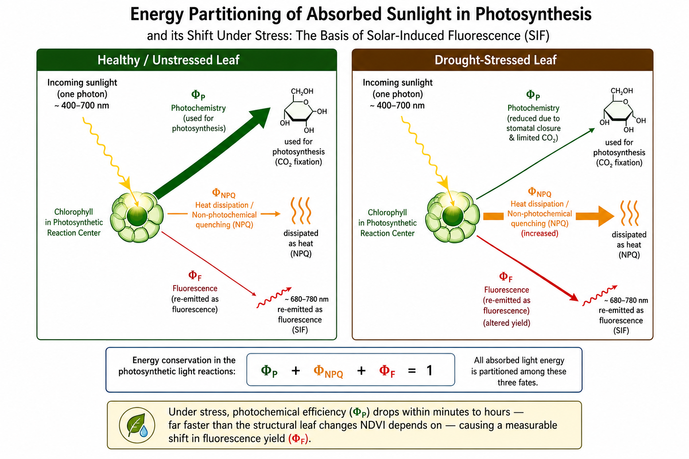

**Figure 1.** Schematic representation of leaf-level light energy partitioning among photochemistry, non-photochemical quenching (heat dissipation), and chlorophyll fluorescence, under well-watered versus drought-stressed conditions.

*Note: This figure was made with an AI image tool and is used only as a visual aid. It is not data or a result of this study.*

### 1.4 Physical Basis of NDVI

NDVI comes from surface reflectance in the red and near-infrared bands:

NDVI = (NIR − RED) / (NIR + RED)

Chlorophyll absorbs red light strongly, so healthy leaves reflect little red light. Inside the leaf, the spongy mesophyll, where air spaces meet cell walls, scatters near-infrared light strongly (Figure 2). A dense and healthy canopy therefore has a big difference between red and near-infrared reflectance and a high NDVI. When the canopy thins or dries, this difference becomes smaller. Over dense canopies NDVI saturates (Huete et al., 2002), so it can stay close to its peak even when leaf area is already going down. I removed cloud and cloud-shadow pixels using MOD13Q1's `SummaryQA` flag (Section 3.1).

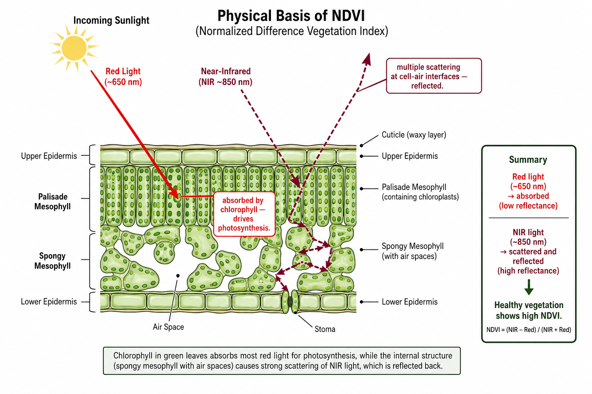

**Figure 2.** Leaf cross-section illustrating red-light absorption by chlorophyll in the palisade mesophyll versus near-infrared scattering at spongy mesophyll air-cell interfaces, the physical basis of the reflectance contrast measured by NDVI.

*Note: This figure was made with an AI image tool and is used only as a visual aid. It is not data or a result of this study.*

### 1.5 Research Questions and Hypotheses

**Table 1.** Research questions, hypotheses and where they are tested.

| Research question | Hypothesis | Section |
|---|---|---|
| RQ1 (main): In drought years, does SIF depart from its normal-year range before NDVI does? | H4: SIF's drought anomaly precedes NDVI's. | 3.9, 3.14, 4.2, 4.11 |
| RQ1b: Does SIF's normal post-peak decline begin before NDVI's? | H1: SIF's seasonal decline begins before NDVI's. | 3.4, 4.3–4.6, 4.11 |
| RQ2: Does the SIF–NDVI lag differ between districts and with drought? | H2: the lag differs between districts. H3 (exploratory): drought widens the lag. | 3.8, 4.7, 4.11 |
| RQ3: How do satellite drought signals time against the rainfall Trigger-1 and the 2015 and 2018 declarations? | — (descriptive) | 3.10, 4.9 |

H3 is exploratory because only two of the nine years (2015, 2018) meet the drought criterion (Section 3.5). The 2001–2014 out-of-sample test adds five more (Section 4.11).

## 2. Study Area

The study covers all eight districts of Marathwada, Maharashtra: Chhatrapati Sambhajinagar (Aurangabad), Jalna, Parbhani, Hingoli, Nanded, Beed (called "Bid" in the FAO GAUL dataset used for the boundaries (FAO, 2015); see Section 3.2), Latur, and Dharashiv (Osmanabad). I chose this region because it has a long history of agricultural drought. Most farming here is rain-fed Kharif cropping (soybean, cotton, pulses, sorghum) during the June–September monsoon.

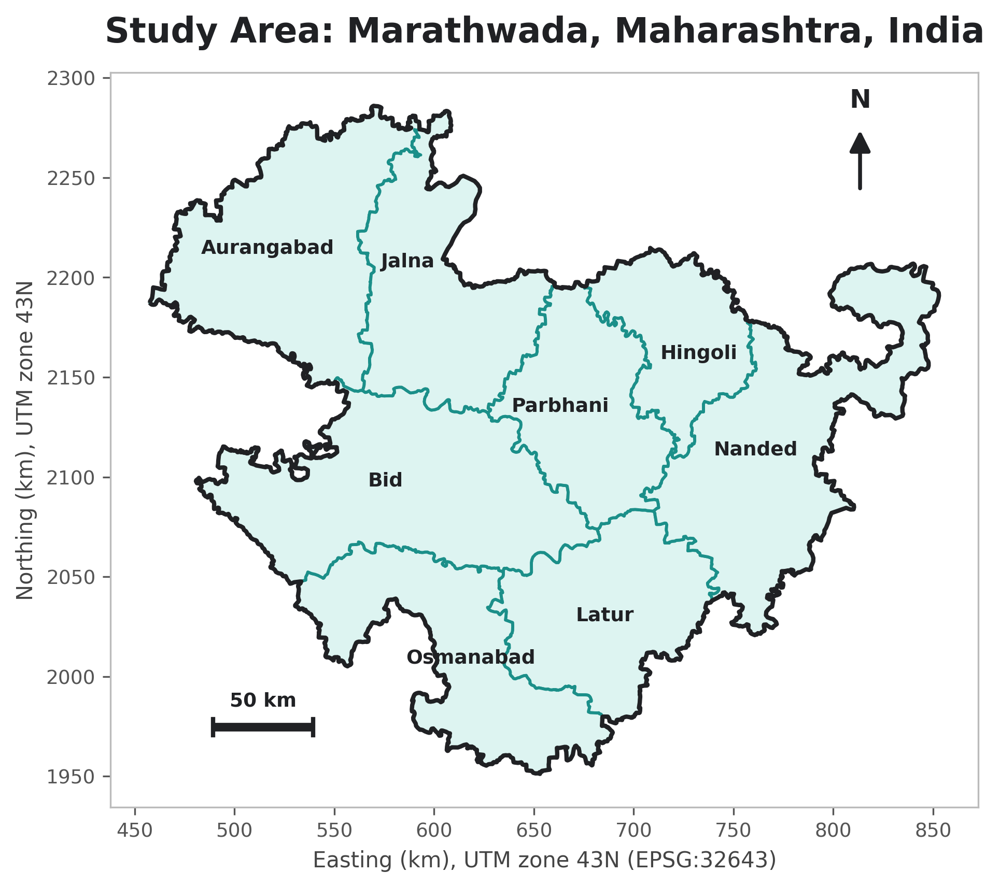

**Figure 3.** Study area: the eight districts of Marathwada, Maharashtra, India, with district boundaries and names.

## 3. Data and Methodology

### 3.1 Data Sources

All analyses use the 1 June – 27 December window (day-of-year 153–361) of nine years, 2015–2023. The out-of-sample test in Section 3.14 uses the same window in 2001–2014.

- **SIF (main):** GOSIF v2, a global 0.05°, 8-day solar-induced fluorescence product (Li & Xiao, 2019), distributed by the Global Ecology Group, University of New Hampshire.
- **SIF (independent check):** TROPOSIF v2.1 Level-2B daily soundings from Sentinel-5P TROPOMI (Guanter et al., 2021), for 2018–2020.
- **NDVI:** MODIS MOD13Q1 (Didan, 2021), 16-day, 250 m, via Google Earth Engine, including its per-pixel `DayOfYear` band (the day each pixel's value was observed).
- **Land cover:** MODIS MCD12Q1 (Friedl & Sulla-Menashe, 2022), IGBP classes 12 (cropland) and 14 (cropland/natural vegetation mosaic).
- **Precipitation:** CHIRPS daily rainfall (Funk et al., 2015), via Google Earth Engine: seasonal totals for 1981–2023 at region and district level, and daily series for the region (2001–2023) and districts (2015–2023). Every rainfall anomaly in this study comes from this one series.
- **Crop yields:** district-season-crop Area/Production/Yield statistics (Ministry of Agriculture & Farmers Welfare, 2024), Kharif season, 1997-98 to 2022-23.
- **Official declarations:** the 2015 Maharashtra drought declaration (reported 16 October 2015; India.com/ANI, 2015), the 2018 first-stage declaration of a drought-like situation (23 October 2018; Deccan Herald, 2018), and the 2018 final Kharif drought declaration (31 October 2018; Zee News, 2018; Economic and Political Weekly, 2018).

Three things about these datasets affect how the results should be read. First, GOSIF is trained on OCO-2 SIF, with MODIS reflectance (including EVI) and MERRA-2 reanalysis as inputs (Li & Xiao, 2019). MOD13Q1 NDVI also comes from MODIS reflectance, so GOSIF and NDVI are not fully independent. This is why I added the TROPOMI check (Section 3.11). Second, the GOSIF grid is 0.05° (about 5 km), much coarser than the 250 m of MOD13Q1. All comparisons are therefore at regional or district scale and say nothing about single fields. Third, class 14 is a mix of cropland and natural vegetation, so "cropland" here means a mixed farming landscape. Classes 12 and 14 together cover about 96–97% of the cells in the study area.

### 3.2 Boundary Definition and Verification

The study boundary comes from the FAO GAUL 2015 level-2 dataset. I selected the eight Marathwada districts and merged them into one polygon, and used this polygon for both the SIF clipping and the NDVI extraction. When I overlaid the polygon on a clipped SIF raster, data remained only inside the district outlines (Figure 4).

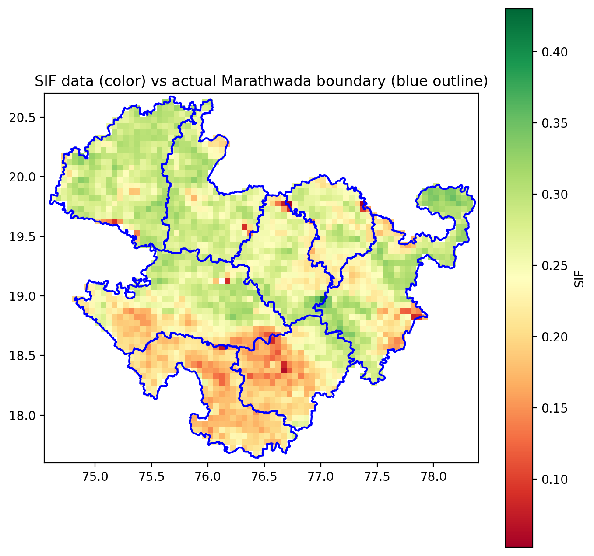

**Figure 4.** Verification of boundary masking: clipped SIF data (color) overlaid with the Marathwada district boundary (blue outline).

### 3.3 Processing Pipeline

**SIF.** GOSIF GeoTIFFs were clipped to the study boundary, scaled by GOSIF's 0.0001 factor, and masked for fill values (32767 water, 32766 snow/ice or barren). Each 0.05° cell was weighted by its cropland fraction, which is the share of MCD12Q1 pixels in classes 12 or 14 inside that cell, computed in Earth Engine on the GOSIF grid. Each 8-day composite is dated at its middle (start day + 3.5).

**NDVI.** I kept MOD13Q1 pixels only where `SummaryQA` shows good or marginal quality and where MCD12Q1 marks the pixel as cropland. A 16-day MOD13Q1 value can come from any day in its window, so I dated each composite by the mean of its pixels' `DayOfYear` values instead of its start date. Each year's NDVI series was normalised on its own observations and then linearly interpolated onto the SIF composite dates. During the monsoon many NDVI composites have few clear pixels. In 23 of 117 regional composites, under 25% of cropland pixels pass the quality screen. Removing these composites does not change the direction of any year's lag. With a stricter 50% cut-off, the 2022 lag becomes negative (−6.2 days; Supplementary Figure S1).

### 3.4 Seasonal Lag Calculation

I rescaled each year's SIF and NDVI series to 0–1. Then, by linear interpolation, I found the day-of-year on which each series first fell below each decline threshold after its peak (0.9, 0.8, 0.7, 0.6, 0.5). The lag at each threshold is the NDVI crossing date minus the SIF crossing date (positive means SIF first). A year's lag is the mean over the thresholds it reaches. I used two rescalings:

- **Season range** (the original method): 0 at the year's seasonal minimum, 1 at its peak. The minimum is usually the pre-monsoon value in June.
- **Decline range**: 0 at the minimum *after* the peak, 1 at the peak, so each series is measured over its own decline.

Both give the same result if both series go back to their pre-season level at the end of the season. If one series does not, the season-range scaling makes it cross every threshold later, because its post-season low point sits partway up the scale. I also fitted an asymmetric double-logistic curve to each series and used the end-of-season inflection date as a third estimate. These fits are unstable with 8- and 16-day data, so I report them only as a sensitivity check (Supplementary Figure S2).

To check whether a remaining lead comes from NDVI itself and has nothing to do with fluorescence, I repeated the same threshold-crossing comparison with two other MOD13Q1 reflectance indices from the same composites, with the same quality and cropland masks. These are EVI and NIRv (NDVI × near-infrared reflectance), which tracks canopy structure and absorbed light (Badgley et al., 2017). I compared SIF with each index, and compared EVI and NIRv with NDVI on their shared observation dates.

### 3.5 Rainfall Anomaly and Drought Classification

For each year I compared the seasonal CHIRPS total (1 June – 26 December) with the 2001–2020 mean and standard deviation, which gives a percentage anomaly and a z-score. A year counts as a drought year when its z-score is below −0.5. June–September totals give the same two drought years. District-years were classified against each district's own 2001–2020 baseline (main) and, as a check, against the regional baseline. The 2001–2020 baseline includes six of the study years, so I repeated the regional classification with three other baselines (2001–2014, 1981–2014, 1991–2020).

### 3.6 Cross-Correlation Lag

As an estimate that does not depend on scale, I used time-lagged cross-correlation over the post-peak decline, starting from SIF's peak. Both series were interpolated to daily values, their means were removed, and they were cross-correlated at shifts from −N/4 to +N/4 days, where N is the length of the decline window. The shift that gives the highest correlation between SIF(t) and NDVI(t + lag) is that year's estimate (positive means SIF first). Correlation does not change with scaling, so the choice of normalisation does not affect this estimate.

### 3.7 Uncertainty

For cross-correlation, I resampled each year's observations 2,000 times and repeated the same search. The 2.5th and 97.5th percentiles give a 95% interval. For threshold-crossing, I smoothed each series (Savitzky–Golay, window 5, order 2), resampled the residuals in moving blocks of three composites (to keep their autocorrelation), added them back to the smooth curve 2,000 times, and recomputed the lag each time. The replicates were centred on the reported lag and not on the lag of the smoothed curve. A leave-one-observation-out jackknife gives a second view. I also combined the per-year draws into an interval for the drought-minus-normal difference. This interval shows measurement uncertainty only and leaves out year-to-year variation.

### 3.8 District-Level Lag (H2, H3)

The same lags were computed for every district-year (8 × 9 = 72). I tested whether the lag differs between districts with a two-way ANOVA (district and year effects) and a Friedman test across the nine years, and compared drought and normal district-years with Welch's t-test.

### 3.9 Drought-Specific Anomaly Signal (H4)

A seasonal lag tells us when each index starts its normal decline. It does not tell us when the index moves away from normal. For each composite date, I standardised each year's SIF (and NDVI) value against the normal years on that date, leaving the year itself out: z = (x − mean of normal years) / s.d. of normal years. For each threshold (−0.5, −1, −1.5, −2, −3), a year's alarm date is the first composite from 1 July at which z stays below the threshold for two composites in a row. For the region, z < −3 is the only threshold where neither index gives an alarm in any normal year, so I use it as the main alarm threshold. I applied the same steps to the 72 district-years: 15 drought and 57 normal against each district's own rainfall baseline (main), and 17 and 55 against the regional baseline (sensitivity). I also measured, date by date, how well each index separates drought from normal district-years, using the area under the ROC curve (AUC). District-years in the same year share the same weather, so the AUCs are only descriptive.

NDVI is placed on the SIF dates by linear interpolation between its observation days. This means the NDVI value on a date already includes part of the next observation, which can be up to about 16 days later. To see how much this matters, I repeated the alarm test using, on each SIF date, the last NDVI value observed by the end of that SIF composite. SIF composites and interpolated NDVI are both 8 days apart, so I count alarm differences of 8 days or less as within one composite.

### 3.10 Rainfall Trigger and Declaration Dates (RQ3)

India's Manual for Drought Management (Ministry of Agriculture & Farmers Welfare, 2016a) begins drought assessment with Trigger-1, which is based on rainfall deviation and dry spells. I approximated it as the first day after 1 July on which cumulative rainfall since 1 June is more than 25% below the 2001–2020 normal for that date and a dry spell (days in a row below 2.5 mm) of at least 21 days has happened. Dry spells were counted only between 1 July and 30 September. I also ran variants: deficit > 20% or > 30%, dry day < 1 mm, deficit alone, dry spell alone, and dry spells counted up to December. The state uses the trigger at taluka level, and averaging rain over a whole district rarely leaves a 21-day dry spell. For this reason I also ran the same rule in every 0.05° CHIRPS pixel. For each district-year I recorded the share of pixels where it fired and the first day that share reached 25% and 50%. Both versions only approximate the taluka-level procedure. I compared the satellite alarm dates with this trigger date and with the three declaration dates.

### 3.11 Independent Check with TROPOMI SIF

I kept TROPOSIF soundings over Marathwada (1 June – 27 December, 2018–2020) where cloud fraction < 0.2, solar zenith angle < 70° and the product's land-cover flag is cropland (12 or 14), and averaged them into 8-day composites that match GOSIF's dates. The main variable is SIF_Corr_743 (Guanter et al., 2021). I also ran three variants (cloud fraction < 0.5, all land cover, uncorrected SIF_743). I computed the seasonal lag against NDVI under both rescalings, and in the same way against MODIS EVI and NIRv (Section 3.4).

### 3.12 Method Dependence

I recomputed the regional lag under 40 combinations of choices. SIF was cropland-weighted or unweighted; NDVI was dated by observation day or by compositing window; series were raw or smoothed; and the lag metric was the mean over thresholds, the 0.9, 0.7 or 0.5 threshold alone, or cross-correlation (all with season-range scaling). For each combination I noted whether SIF leads in all nine years, whether drought years have a smaller mean lag than normal years, and whether 2018 has the smallest lag.

### 3.13 Spatial Autocorrelation and Crop-Yield Check

I computed Moran's I every year for district SIF and rainfall anomaly, using Queen-contiguity weights (9,999 permutations). For the yield check, I took every district-crop pair with at least 10 of the 26 Kharif seasons, converted its yields to z-scores against its own mean and standard deviation, and averaged them into a Yield Anomaly Index for each district-year and each region-year (n = 8 region-years, because the yield data end in 2022-23).

### 3.14 Out-of-Sample Test, 2001–2014

After I finished the 2015–2023 analysis, I ran it again on 2001–2014, the GOSIF years before the study period, without changing anything. The drought rule, the alarm rule and its thresholds, the cropland weighting (with each year's MCD12Q1 map), the NDVI quality screen and observation-day dating, and both lag scalings are the same as in Sections 3.3–3.9. I did not re-tune anything on the new years. Anomalies are standardised against the normal years of 2001–2014 only, so no vegetation data from 2015–2023 is used in this test. Drought years are still defined against the 2001–2020 rainfall baseline, as in the main analysis. Before extracting the new years, I extracted 2015 again with the same code, and it matched the main series exactly (largest difference about 10⁻¹⁶). TROPOMI does not cover these years, and I did not repeat the district-level lag tests (H2).

## 4. Results

### 4.1 Rainfall and Drought Years

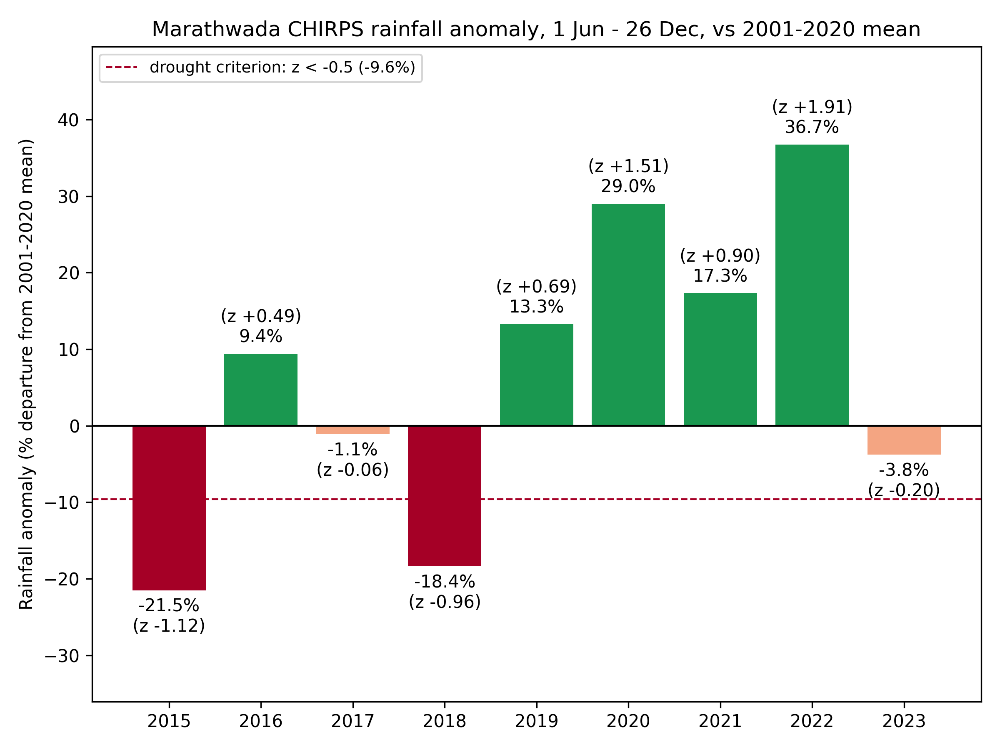

**Figure 5.** Regional June–December rainfall anomaly (% departure from the 2001–2020 mean), 2015–2023, with z-scores; dark red = drought years (z < −0.5).

The 2001–2020 mean is 826.8 mm (σ = 158.9 mm). Against it, the nine years were 649.0 mm in 2015 (−21.5%, z = −1.12); 904.7 mm in 2016 (+9.4%, z = 0.49); 817.4 mm in 2017 (−1.1%, z = −0.06); 674.9 mm in 2018 (−18.4%, z = −0.96); 936.3 mm in 2019 (+13.3%, z = 0.69); 1066.5 mm in 2020 (+29.0%, z = 1.51); 970.0 mm in 2021 (+17.3%, z = 0.90); 1130.3 mm in 2022 (+36.7%, z = 1.91, the wettest season since 1981); and 795.3 mm in 2023 (−3.8%, z = −0.20). Only 2015 and 2018 meet the drought criterion, and this is true under all four baselines. With the 2001–2020 baseline it holds for every cut-off from −0.3 to −0.75. With the 1981–2014 baseline, 2018 (z = −0.65) drops out at cut-offs of −0.7 and below. 2023 is a borderline year. Its seasonal total is close to normal, but August had only 51 mm (z = −2.52), and Maharashtra declared drought in 40 talukas on 31 October 2023 (Morung Express/IANS, 2023). By the same rule, 2001, 2002, 2003, 2004 and 2014 are also drought years, and Section 4.11 uses them as an out-of-sample test.

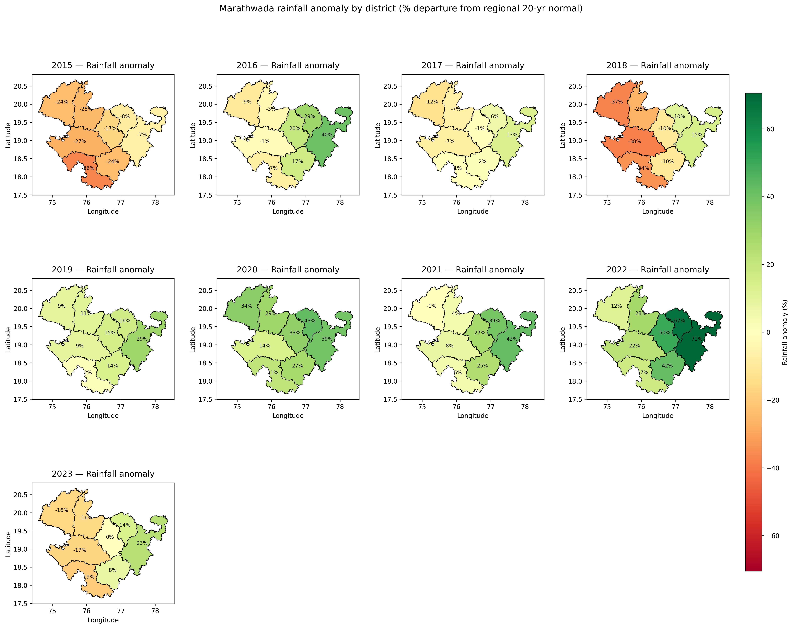

**Figure 6.** Rainfall anomaly by district (% departure from the regional 2001–2020 mean), 2015–2023.

The rainfall deficit was not the same everywhere. In 2018, Bid (−38.0%), Aurangabad (−37.3%) and Osmanabad (−33.9%) had the largest deficits, while Hingoli (+10.2%) and Nanded (+14.6%) got more rain than normal. In 2015, Osmanabad (−36.4%) had the largest deficit, and Hingoli (−8.0%) and Nanded (−7.1%) the smallest. Against each district's own baseline, 15 district-years are drought years: all eight districts in 2015, six in 2018 (all except Hingoli and Nanded), and Jalna in 2023.

### 4.2 Is There a Drought-Specific SIF Advantage? (H4)

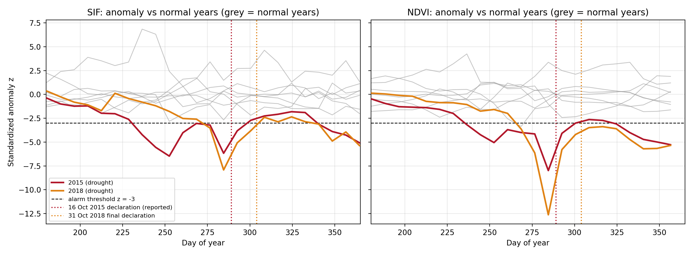

**Figure 7.** Standardised SIF and NDVI anomalies relative to normal years, by composite date; 2015 red, 2018 orange, normal years grey. The dashed line marks the alarm threshold z = −3; the dotted vertical lines mark the 2015 declaration and the 2018 final declaration.

For the region at z < −3, SIF and NDVI both gave the 2015 alarm on 24 August. In 2018 NDVI gave it on 25 September and SIF on 3 October, one composite (eight days) later. At z < −1, SIF came first in both drought years (by 8 days in 2015 and 32 in 2018). But at that threshold each index also gave alarms in five of the seven normal years, so this threshold cannot tell drought seasons from normal ones. In 2018 both indices reached their lowest anomaly on the same composite (11 October), and NDVI dropped further (z = −12.6 vs −7.9).

**Table 2.** Drought alarms in district-years, own-district rainfall baseline (15 drought, 57 normal district-years).

| Threshold | Drought flagged, SIF | Drought flagged, NDVI | False alarms, SIF | False alarms, NDVI | Both flagged | SIF earlier | Same date | NDVI earlier | Within one composite |
|---|---|---|---|---|---|---|---|---|---|
| z < −1.5 | 15 | 15 | 22 | 24 | 15 | 2 | 4 | 9 | 9 |
| z < −2 | 14 | 15 | 11 | 12 | 14 | 4 | 4 | 6 | 9 |
| z < −3 | 12 | 13 | 2 | 4 | 12 | 7 | 2 | 3 | 11 |

At the main threshold, SIF was earlier in 7 of the 12 drought district-years flagged by both, they were on the same date in 2, and NDVI was earlier in 3. In 11 of the 12, the gap was one composite or less. At looser thresholds NDVI was earlier more often (9 against 2 at z < −1.5, 6 against 4 at z < −2), again mostly by one composite (Table 2). SIF had slightly fewer false alarms. With the regional baseline instead (17 drought district-years), both flag 12 at z < −3; SIF is earlier in 5, the same in 4 and later in 3. The date-by-date AUC shows SIF separating drought from normal district-years from 23 July (AUC 0.80) and NDVI from 31 July (0.76). SIF's AUC is higher from 15 to 31 July and again on 24 August–1 September. NDVI's is higher in late June–early July (when both are near 0.5) and on 8–16 August. From 9 September to 20 November the two differ by about 0.02 at most, and by up to 0.06 in late November and early December.

These gaps are about as long as the sampling interval of the data, or shorter, and their direction changes with how NDVI is placed in time (Section 3.9). When I used only the NDVI observed by the end of each SIF composite, SIF came first at z < −3 in both regional drought years (by 8 days each) and in 8 of the 12 district-years flagged by both (same date in 3, NDVI earlier in 1).

H4 is therefore not supported in the way I set out to test it. With the time resolution of these data, SIF did not give a drought alarm that was earlier every time, and NDVI did not either. The two alarms were usually one composite apart or less, their order changed with the NDVI dating, and the only steady difference was that SIF gave slightly fewer false alarms.

### 4.3 Seasonal SIF–NDVI Trajectories

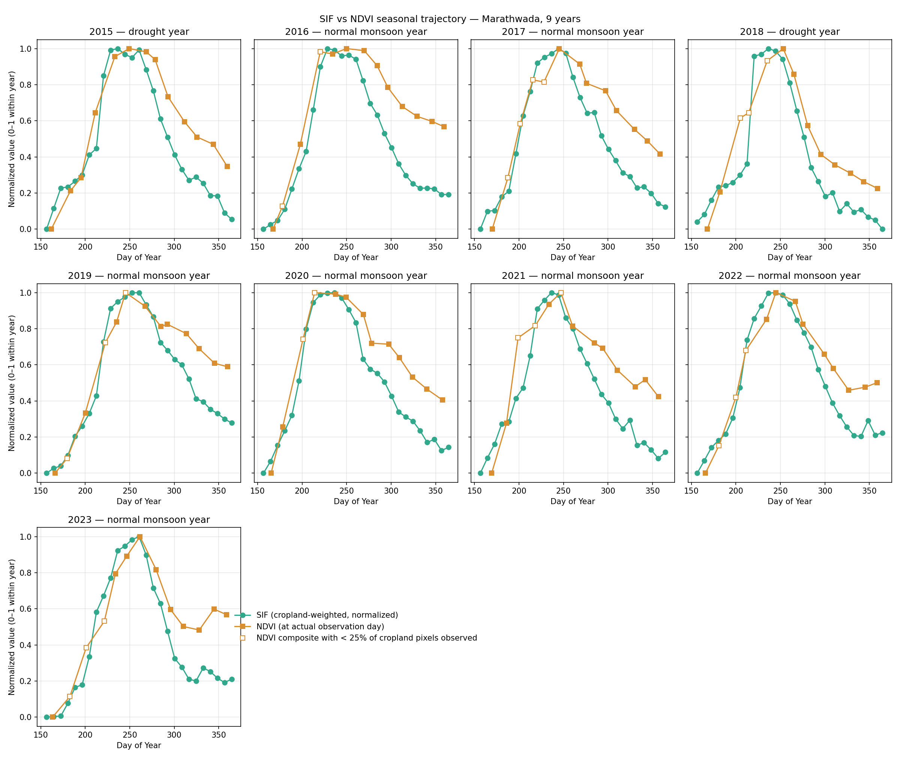

**Figure 8.** Normalised cropland-weighted SIF and NDVI (at observation day) seasonal trajectories, Marathwada, 2015–2023 (season-range scaling). Open squares mark NDVI composites in which fewer than 25% of cropland pixels passed the quality screen.

With season-range scaling, SIF's post-peak decline seems to start before NDVI's in all nine years, and NDVI stays near its peak for longer. Figure 8 also shows why the scaling is important. By late December SIF is back close to its June level (0.00–0.28 on the season scale), but NDVI is still higher (0.23–0.59). After the monsoon NDVI stays well above its pre-monsoon level, probably because of leftover vegetation, Rabi sowing and weeds on fallow land.

### 4.4 Threshold-Crossing Lag and Its Dependence on Normalisation

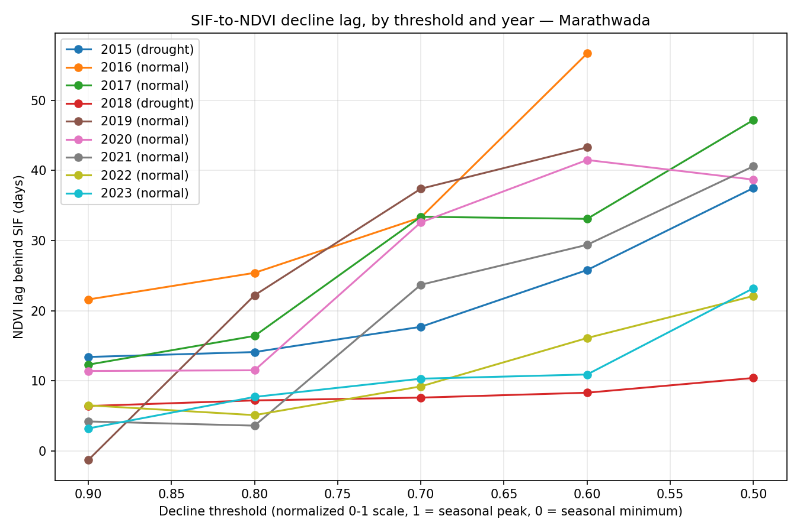

**Figure 9.** SIF-to-NDVI decline lag (days), by decline threshold and year (season-range scaling).

With season-range scaling, the lag was 21.7 days (2015), 34.2 (2016), 28.5 (2017), 8.0 (2018), 25.4 (2019), 27.1 (2020), 20.3 (2021), 11.8 (2022) and 11.1 (2023). All of them are positive, and the lag gets bigger at deeper thresholds (Figure 9). The moving-block bootstrap puts every year above zero (95% intervals: 2015 [16.3, 30.4]; 2016 [12.5, 39.6]; 2017 [17.5, 32.5]; 2018 [2.8, 16.1]; 2019 [8.9, 33.0]; 2020 [18.6, 34.4]; 2021 [4.0, 25.2]; 2022 [5.3, 14.9]; 2023 [7.6, 16.6]). In 8 of the 36 pairs of years, the intervals do not overlap.

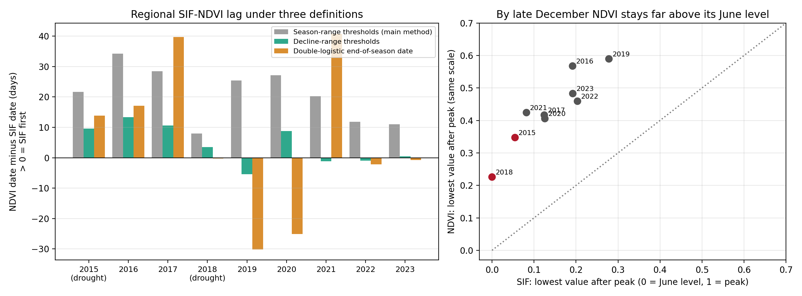

**Figure 10.** Regional SIF–NDVI lag by year under season-range scaling, decline-range scaling, and the double-logistic end-of-season date.

This lead depends on the scaling. When each series is scaled from its peak to its own post-peak minimum, the lag becomes 9.6 (2015), 13.4 (2016), 10.6 (2017), 3.5 (2018), −5.5 (2019), 8.8 (2020), −1.2 (2021), −1.0 (2022) and 0.4 (2023) days. SIF is first in six years, by 0.4–13.4 days, and NDVI is first by 1–6 days in 2019, 2021 and 2022 (Figure 10). The double-logistic end-of-season date gives lags from −30 to +41 days with no clear direction, and the fits are unstable (Supplementary Figure S2). The lead shrinks most in the years when NDVI's post-season level sits much higher than SIF's. Across the nine years, this gap (on the season scale) and the difference between the two lags correlate at r = 0.67.

**Table 3.** Regional results by year and method.

| Year | Drought? | Season-range lag (days) | Block-bootstrap 95% interval | Decline-range lag (days) | Cross-correlation lag (days) | Cross-correlation 95% interval |
|---|---|---|---|---|---|---|
| 2015 | Yes | +21.7 | [16.3, 30.4] | +9.6 | +10 | [6, 13] |
| 2016 | No | +34.2 | [12.5, 39.6] | +13.4 | +12 | [8, 15] |
| 2017 | No | +28.5 | [17.5, 32.5] | +10.6 | +14 | [−20, 28] |
| 2018 | Yes | +8.0 | [2.8, 16.1] | +3.5 | +4 | [0, 6] |
| 2019 | No | +25.4 | [8.9, 33.0] | −5.5 | 0 | [−20, 24] |
| 2020 | No | +27.1 | [18.6, 34.4] | +8.8 | +9 | [−28, 28] |
| 2021 | No | +20.3 | [4.0, 25.2] | −1.2 | +20 | [−4, 30] |
| 2022 | No | +11.8 | [5.3, 14.9] | −1.0 | −1 | [−5, 3] |
| 2023 | No | +11.1 | [7.6, 16.6] | +0.4 | −3 | [−10, 0] |

### 4.5 Cross-Correlation and Its Uncertainty

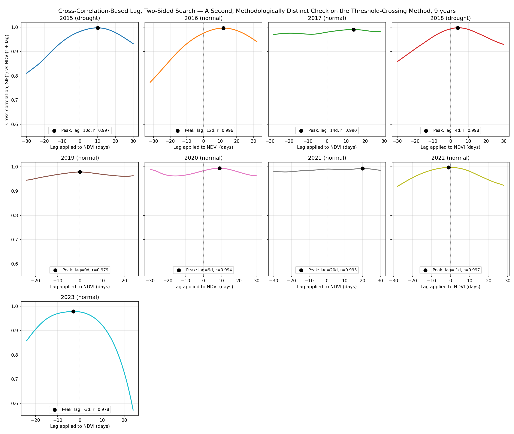

**Figure 11.** Cross-correlation between SIF and NDVI as a function of the lag applied to NDVI, by year. Black markers show the correlation-maximising lag; a negative lag means NDVI leads SIF.

Cross-correlation does not depend on scaling. The shift with the highest correlation was 10 days (2015), 12 (2016), 14 (2017), 4 (2018), 0 (2019), 9 (2020), 20 (2021), −1 (2022) and −3 (2023), with peak correlations of 0.979–0.998. The correlation curves are very flat. Even at zero shift the correlation is already 0.975–0.993, so the best shift is hard to pin down.

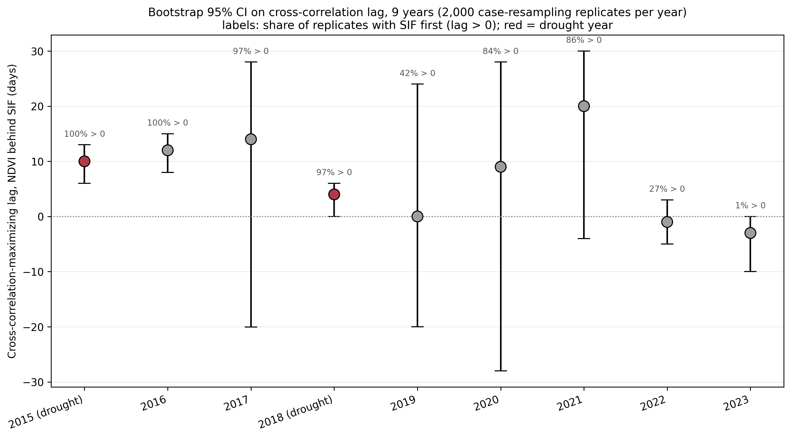

**Figure 12.** Cross-correlation lag point estimates with 95% bootstrap intervals (case resampling, 2,000 replicates per year), labelled with the percentage of replicates showing a SIF lead.

The 95% intervals lie fully on the SIF-lead side only in 2015 and 2016. In 2018 the interval touches zero, and in 2023 it leans towards NDVI (Table 3). Cross-correlation and the decline-range lag mostly agree. Both put 2015 and 2016 among the clearest SIF leads, and both find no lead in 2019, 2022 and 2023. These two methods point to a small SIF lead that changes from year to year. They do not support the steady three-week lead of the season-range method.

### 4.6 Independent Check with TROPOMI SIF

**Table 4.** TROPOMI (TROPOSIF v2.1) versus GOSIF, 2018–2020. Lags are NDVI crossing minus SIF crossing (days).

| Year | Composites | r (TROPOMI vs GOSIF) | Peak DOY TROPOMI | Peak DOY GOSIF | Season-range lag, TROPOMI | Season-range lag, GOSIF | Decline-range lag, TROPOMI | Decline-range lag, GOSIF |
|---|---|---|---|---|---|---|---|---|
| 2018 | 26 | 0.91 | 244.5 | 236.5 | 12.8 | 8.0 | 10.4 | 3.5 |
| 2019 | 26 | 0.97 | 252.5 | 260.5 | 43.8 | 25.4 | 10.3 | −5.5 |
| 2020 | 26 | 0.97 | 212.5 | 236.5 | 45.3 | 27.1 | 27.7 | 8.8 |

Of 630,091 soundings inside Marathwada on 540 days, 53% passed the cloud filter. TROPOMI follows GOSIF's seasonal curve closely (r = 0.91–0.97). It also puts SIF's decline before NDVI's in all three years under both scalings, though by different amounts. The four TROPOMI variants agree (season-range lags 10.8–45.9 days, none negative). In 2020 TROPOMI peaks earlier than GOSIF and its lead is larger, so the size of the lead differs between the two products. Both products show the 2018 drop compared with 2019–2020 (correlation of the two ratio series, August–October, r = 0.91). With only two normal TROPOMI years, I could not yet run a useful TROPOMI version of the H4 anomaly test.

**Other reflectance indices.** EVI and NIRv, from the same MOD13Q1 composites, also declined before NDVI. NIRv did so in all nine years (mean +22.8 days season-scaled, +9.9 days decline-scaled), and EVI in nine and eight years (+17.1 and +7.7 days). These leads are as large as SIF's (+20.9 and +4.3 days). When compared directly, GOSIF did not decline before NIRv. It was first in 4 of 9 years season-scaled (mean −1.8 days) and in none decline-scaled (mean −6.1 days). For GOSIF, then, NIRv, an index of canopy structure and absorbed light, has the same lead over NDVI, and this lead comes from NDVI's late decline. GOSIF itself is predicted from MODIS reflectance (Section 3.1), so some agreement with NIRv is expected. TROPOMI does not use MODIS data. It declined before NIRv in all three of its years, by 5.4, 7.8 and 13.1 days season-scaled and 4.6, 1.2 and 12.5 days decline-scaled (2018–2020), and before EVI by 3.0–20.8 days. Across the four TROPOMI variants it came first against NIRv in 23 of 24 year-and-scaling cases. Three years, with only one drought year, are not enough to show a lead that comes from fluorescence itself. Still, with these results I cannot say that all of SIF's lead is an NDVI effect.

### 4.7 Method Dependence and District-Level Lags (H2, H3)

Across the 40 combinations of Section 3.12 (all season-range), SIF leads in all nine years in all 8 mean-threshold combinations, in 4 of 8 at the 0.9 threshold, and in none of the 8 cross-correlation combinations. Using unweighted SIF and NDVI paired by window changes individual years' mean lag by −2.5 to +2.6 days. Cropland weighting changes lags by at most 0.2 days. These choices matter much less than the scaling.

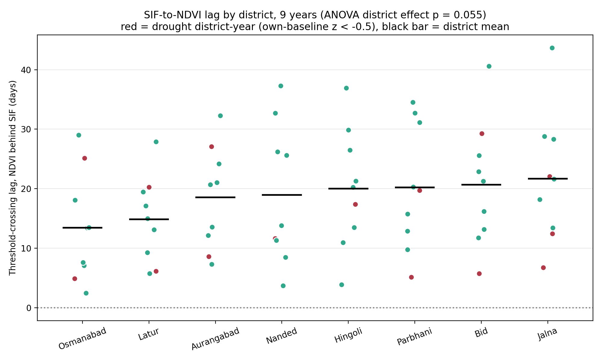

**Figure 13.** Season-range SIF–NDVI lag by district and year.

With season-range scaling, SIF's decline came first in all 72 district-years (median 17.7 days, range 2.4–43.6). The district effect is significant in the Friedman test (χ² = 14.5, p = 0.043) and borderline in the two-way ANOVA (p = 0.055). With decline-range scaling, SIF is first in 52 of 72 district-years (median 2.3 days, range −8.1 to 19.9), district means range only from 2.9 to 5.6 days, and the Friedman test finds no district effect (p = 0.97). H2 is therefore not supported. The district differences under the first scaling come from how high NDVI stays after the season in each district.

H3 is not supported either. For the region, drought years had a smaller season-range lag than normal years (14.8 vs 22.6 days) and a slightly larger decline-range lag (6.5 vs 3.6 days). With two drought years, neither difference can be interpreted. The block-bootstrap drought-minus-normal difference for the season-range lag is −7.8 days, with a measurement-only interval of [−9.9, +1.8]. At district level (own baseline), drought district-years average 14.8 vs 19.5 days (season range, Welch p = 0.080) and 5.8 vs 3.4 days (decline range, p = 0.13).

### 4.8 Spatial SIF Pattern and Spatial Autocorrelation

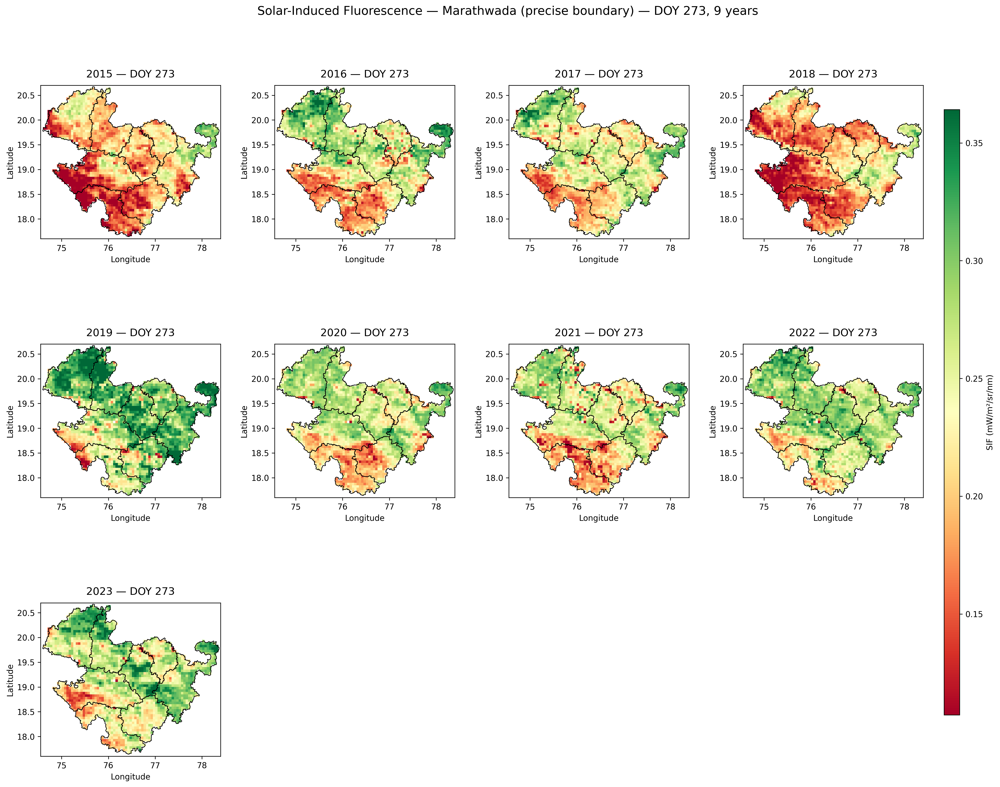

**Figure 14.** Spatial SIF distribution, day-of-year 273, 2015–2023.

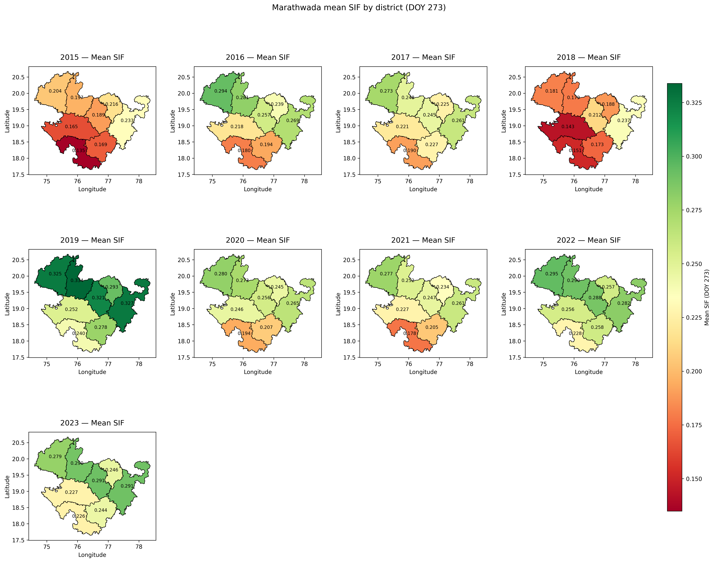

**Figure 15.** Mean SIF by district, day-of-year 273, 2015–2023.

Osmanabad has the lowest district SIF on day-of-year 273 in eight of nine years; in 2018 Bid (0.143) is lower than Osmanabad (0.151). The highest-SIF district varies: Aurangabad in five years, Nanded in two (2015, 2018), Jalna and Parbhani in one each.

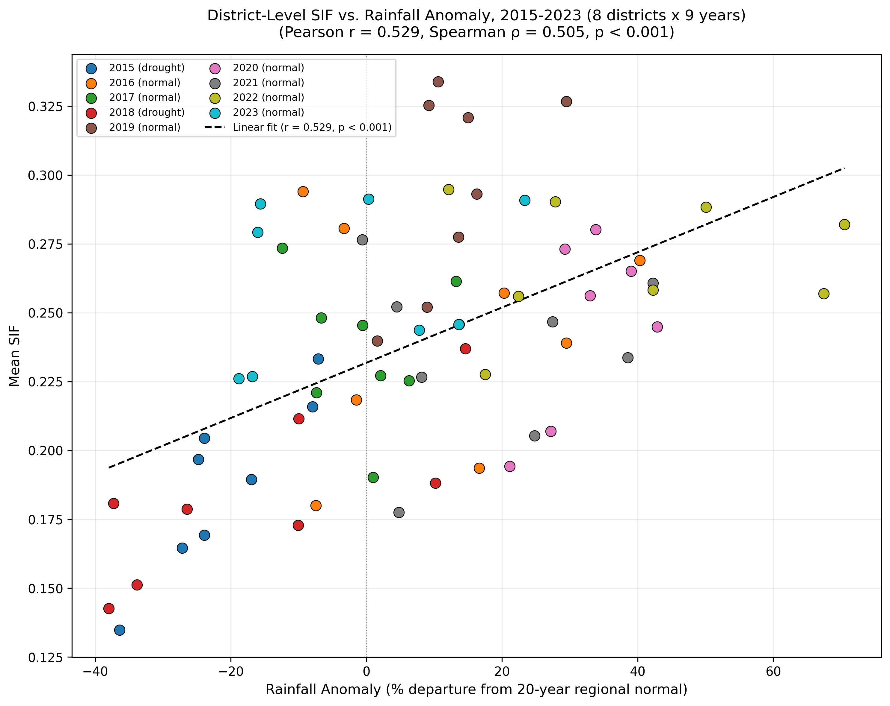

**Figure 16.** District-level SIF (day-of-year 273) against rainfall anomaly, 72 district-years.

District SIF and rainfall anomaly are correlated across the 72 district-years (day-of-year 273: Pearson r = 0.53, Spearman ρ = 0.51, both p < 0.0001; p = 0.001 with standard errors clustered by year). Season-mean SIF has a stronger correlation (r = 0.74), also within years (r = 0.66). With district and year fixed effects, the relationship is not significant (p = 0.37 for season-mean SIF). SIF and rainfall move together across years and across districts, but SIF does not reliably follow a district's change from its own average in a given year.

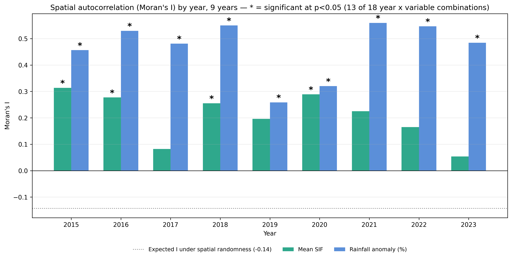

**Figure 17.** Moran's I for district SIF (day-of-year 273) and rainfall anomaly, by year (* = p < 0.05).

Rainfall anomaly is spatially clustered in all nine years (Moran's I 0.26–0.56). Day-of-year-273 SIF is clustered in four years, and season-mean SIF in all nine (I = 0.29–0.54). District observations are therefore not independent, and the clustered and fixed-effects results above are the ones to rely on.

### 4.9 Satellite Signals, the Rainfall Trigger and Official Declarations (RQ3)

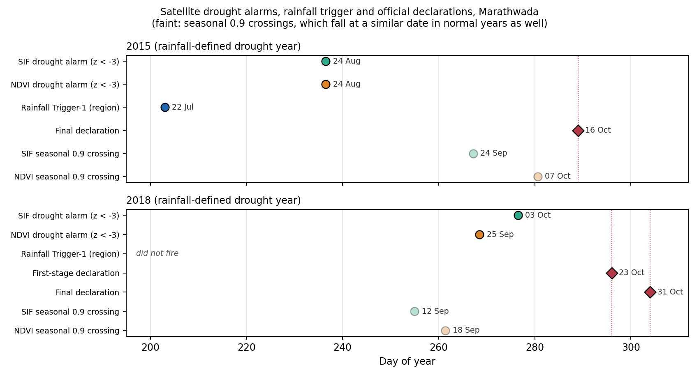

**Figure 18.** Timeline of the 2015 and 2018 seasons: SIF and NDVI drought alarms (z < −3), the regional Trigger-1 approximation (did not fire), the declaration dates, and, faintly, the seasonal 0.9 crossings.

**Rainfall trigger.** With dry spells counted only during the monsoon, the Trigger-1 approximation never fired for the region as a whole. At district level it fired in 2 of the 15 drought district-years, Aurangabad 2018 (3 October) and Bid 2018 (17 September), and in one normal district-year (Bid 2017, 10 August). In Aurangabad both alarms came 15.5 days before the trigger. In Bid 2018 the SIF alarm came 0.5 days after it and the NDVI alarm 8.5 days after it. The deficit rule alone fires in 10 drought and 18 normal district-years, and for the region in 2015, 2017, 2019 and 2023. The dry-spell rule alone fires in 2 drought and 5 normal district-years. If dry spells are counted up to December, as in an earlier version of this analysis, the trigger fires in 4 drought district-years, mostly after the monsoon. Checking every CHIRPS pixel gives the same result. The trigger covered 25% of a district's area in only three district-years: Aurangabad 2018 (40%, 18 September), Bid 2018 (35%, 17 September) and Bid 2017, a normal year (72%, 10 August). In 2015, the stronger drought year, it fired in at most 7% of any district. In Aurangabad 2018 both alarms came 0.5 days before the pixel-level trigger, and in Bid 2018 the SIF alarm came 0.5 days and the NDVI alarm 8.5 days after it. The trigger is rare because of the rule itself in this region, and spatial averaging does not explain it. On its own, the deficit rule separates drought from normal years only weakly. It fires in 10 of 15 drought district-years but also in 18 of 57 normal ones, and for the region it fires in three normal years and misses 2018.

**Declarations.** The drought alarms (z < −3) of both indices came 52.5 days before the 2015 declaration (16 October). They came 27.5 (SIF) and 35.5 (NDVI) days before the 2018 final declaration (31 October), and 19.5 and 27.5 days before the 2018 first-stage declaration (23 October). The seasonal 0.9 crossings (Figure 18, faint) happen at about the same time every year. They show the normal start of the decline and say nothing about drought.

Under the Manual for Drought Management, a declaration comes only after a series of triggers that ends with field checks of crop damage (Ministry of Agriculture & Farmers Welfare, 2016a). Because of this, a satellite signal will nearly always come before the declaration, and the rainfall trigger is a more useful point of comparison. In the two cases where it fired, the satellite alarms came on the same date (Aurangabad) or SIF one composite before NDVI (Bid), and both were about as early as the trigger or earlier.

### 4.10 Crop-Yield Check

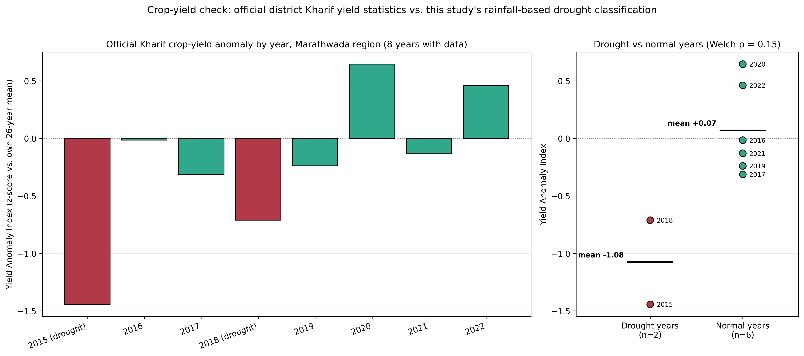

**Figure 19.** Marathwada Kharif Yield Anomaly Index by year (points per year and group means), with rainfall anomaly.

The Yield Anomaly Index (127 district-crop pairs, 16 crops) follows rainfall closely (r = 0.93, p = 0.0009, n = 8). Its correlation with season-mean (June–December) regional SIF is r = 0.88 (p = 0.004). It is r = 0.80–0.85 (p = 0.007–0.017) in versions without zero yields and outliers, area-weighted, detrended and with major crops only. With day-of-year-273 SIF alone it is r = 0.67 (p = 0.071). At district level, with district and year fixed effects, the yield index is still linked to season-mean SIF (p = 0.015–0.040 across versions). The two drought years had a mean index of −1.08 against +0.07 for the six normal years with data (Welch p = 0.15). Harvests were lower in the drought years, as expected, but the difference is not significant with only two drought years. This check supports the drought classification. It does not tell us anything about timing within the season.

### 4.11 Out-of-Sample Test, 2001–2014

Five of the fourteen years are drought years under the same rule: 2001 (z = −0.52, just past the cut-off), 2002 (−1.27), 2003 (−1.01), 2004 (−1.35) and 2014 (−1.12). Against each district's own baseline, 40 of the 112 district-years are drought district-years. The vegetation anomalies in these years were weaker than in 2015 and 2018. At z < −3, which again gave no alarm in any of the nine normal years, SIF flagged two of the five drought years and NDVI one (Table 5).

**Table 5.** Out-of-sample drought alarms, 2001–2014, with all methods unchanged. Region: 5 drought and 9 normal years. Districts (own rainfall baseline): 40 drought and 72 normal district-years. "First" counts a year in which only one index raised the alarm as that index being first.

| Threshold | Region: drought flagged, SIF / NDVI | Region: first SIF / same / NDVI | Region: false alarms, SIF / NDVI | Districts: drought flagged, SIF / NDVI | Districts: false alarms, SIF / NDVI | Districts, both flagged: SIF earlier / same / NDVI earlier |
|---|---|---|---|---|---|---|
| z < −1 | 5 / 5 | 3 / 1 / 1 | 5 / 6 | 38 / 38 | 40 / 42 | 15 / 9 / 13 |
| z < −1.5 | 5 / 4 | 4 / 1 / 0 | 2 / 3 | 25 / 25 | 16 / 25 | 5 / 11 / 6 |
| z < −2 | 2 / 3 | 2 / 0 / 1 | 2 / 1 | 14 / 21 | 7 / 12 | 0 / 7 / 6 |
| z < −3 | 2 / 1 | 1 / 1 / 0 | 0 / 0 | 3 / 6 | 0 / 1 | 0 / 1 / 1 |

For the region, the out-of-sample years lean towards SIF. At z < −3, SIF flagged 2001 (17 September) and 2002 (25 September), and NDVI flagged only 2002, on the same date. At z < −1.5, SIF was first in four drought years and NDVI in none, with one tie. SIF was earlier by 8 days in 2001 and 2002 and by 64 days in 2014, and in 2004 NDVI did not reach the threshold. SIF also gave fewer false alarms at that threshold (2 against 3 of the 9 normal years).

At district level, where the sample is eight times larger, the results look like those of 2015–2023, and neither index is first every time. At every threshold NDVI flagged as many drought district-years as SIF, or more. Where both flagged a district-year, SIF was earlier in 15 of 37 at z < −1, NDVI in 13, and 9 were on the same date. At z < −1.5 the counts were 5, 6 and 11, and at z < −2 they were 0, 6 and 7. At z < −1.5, 17 of the 22 differences were one composite or less. SIF again gave fewer false alarms (16 against 25 at z < −1.5; 7 against 12 at z < −2). At z < −3 only two drought district-years were flagged by both, one on the same date and one with NDVI earlier. The regional series is an average of districts that differ in timing and in their normal-year spread, so regional and district alarms do not have to agree.

Taking both periods together, there are seven drought years for the region and 55 drought district-years. SIF flagged four of the drought years at z < −3 and NDVI three. Where both flagged, they were on the same date twice and NDVI was earlier once. Among the drought district-years flagged by both, SIF was earlier in 7 of 37 at z < −1.5, NDVI in 15, and 15 were on the same date. At z < −3, SIF was earlier in 7 of 14, NDVI in 4, and 3 were on the same date. H4 is still not supported. Neither index is earlier every time and most differences are one composite, even though in 2001–2014 the regional series gave SIF a small advantage.

**Table 6.** Regional seasonal lags in both periods (days; > 0 means the first-named series declines first). "First" is the number of years in which the first-named series declined first.

| Comparison | Scaling | 2015–2023: first | 2015–2023: mean | 2001–2014: first | 2001–2014: mean | 2001–2014: drought / normal mean |
|---|---|---|---|---|---|---|
| SIF vs NDVI | Season range | 9 of 9 | +20.9 | 14 of 14 | +27.4 | +28.3 / +26.9 |
| SIF vs NDVI | Decline range | 6 of 9 | +4.3 | 13 of 14 | +8.3 | +7.6 / +8.6 |
| NIRv vs NDVI | Season range | 9 of 9 | +22.8 | 14 of 14 | +26.6 | +28.9 / +25.3 |
| NIRv vs NDVI | Decline range | 9 of 9 | +9.9 | 14 of 14 | +13.8 | +17.8 / +11.5 |
| SIF vs NIRv | Season range | 4 of 9 | −1.8 | 10 of 14 | +1.9 | +0.2 / +2.9 |
| SIF vs NIRv | Decline range | 0 of 9 | −6.1 | 3 of 14 | −6.4 | −12.4 / −3.0 |

The seasonal results repeat (Table 6). Season-scaled, SIF declined before NDVI in all 14 years (mean +27.4 days), and NIRv did almost exactly the same (+26.6 days). Decline-scaled, SIF was first in 13 years (+8.3 days), but NIRv's lead over NDVI was bigger (+13.8 days), and NIRv declined before SIF in 11 of the 14 years (mean −6.4 days). Again a reflectance index has the same lead over NDVI. The lead is also not larger in drought years (season-scaled +28.3 against +26.9 days; decline-scaled +7.6 against +8.6), so H3 is not supported with five drought years either.

## 5. Discussion

I did not find what I expected for my main question. When each index is compared with its own normal years, GOSIF SIF does not give a consistently earlier drought alarm than NDVI in Marathwada. For the region, the alarms came on the same date in 2015, and NDVI was one composite earlier in 2018. In the drought district-years the gap between them was mostly zero or eight days. SIF was more often first at the strictest threshold, and NDVI at the looser ones. A gap of one 8-day composite is shorter than NDVI's 16-day sampling, and the order flips when I use the observed NDVI values in place of interpolated ones. With this data I cannot tell which index moves first. H4 is not supported.

The out-of-sample test on 2001–2014, with every method kept the same, mostly gives the same picture. At district level, with 40 more drought district-years, the alarms were again mostly on the same date or one composite apart, in both directions. The seasonal lead again matched NIRv's and did not grow in drought years. The regional alarms leaned towards SIF. SIF flagged one drought year (2001) in which NDVI did not reach the strict threshold, and SIF was first in four of five years at a looser threshold. The regional series alone cannot answer the question, and over 2001–2023 as a whole I see no consistent SIF advantage. Also, GOSIF is trained on OCO-2 soundings, which start in September 2014, so for 2001–2014 GOSIF is a prediction outside its training period.

My second result, that SIF's seasonal decline starts before NDVI's, depends on how the decline is measured. When each curve is scaled over the whole season, SIF crosses every threshold first, in every year and every district-year. But in this region NDVI does not go back to its pre-monsoon level after the season, while SIF mostly does. On the season scale, NDVI's decline is measured against a low point it never reaches, so it crosses each threshold later. When each series is scaled over its own decline, the lead shrinks to 0–13 days and disappears in three years. The district differences disappear too, and cross-correlation, which does not depend on scaling, agrees with the smaller estimate. The other reflectance indices help explain the GOSIF lead that remains. NIRv and EVI, from the same MODIS composites, lead NDVI by as much as GOSIF does, and GOSIF does not lead NIRv. For GOSIF, the lead therefore comes from NDVI itself, which saturates over dense canopy and returns slowly to its pre-season level. TROPOMI, which does not use MODIS reflectance, declined before NIRv in all three of its years, by 1–13 days. A small lead that comes from fluorescence is still possible, but three years, with one drought year, cannot show it.

Both results fit the idea that, at 5 km and 8- to 16-day resolution, GOSIF behaves mostly like a greenness and absorbed-light signal. GOSIF is predicted from MODIS EVI and reanalysis weather (Li & Xiao, 2019), and canopy SIF is driven mainly by APAR and structure (Dechant et al., 2020). It would be strange if GOSIF carried a separate early stress signal, and the NIRv result shows that at these scales it does not. Whether direct SIF measurements carry such a signal is still unknown. The TROPOMI lead over NIRv is small and based on three years, and the next step is to test more TROPOMI years.

For policy, the rainfall trigger is a better point of comparison than the declaration. The trigger rarely fires, both on averaged rainfall and pixel by pixel. Its deficit rule on its own fires in more normal than drought district-years (18 against 10) and missed the 2018 drought for the region. Where the trigger did fire, satellite vegetation anomalies were about as early. This supports using vegetation anomalies in drought monitoring. It gives no reason to choose GOSIF SIF over the NDVI that is already in use.

## 6. Limitations

- **Few drought years.** Only 2015 and 2018 meet the regional drought criterion in 2015–2023. The 2001–2014 test adds five more, but their vegetation anomalies were weaker, so at the strict alarm threshold it adds only two flagged drought years. Regional drought-versus-normal comparisons still rest on few seasons, and district-years within one season are not independent.
- **Normalisation dependence.** The seasonal lead depends on how each series is scaled (Section 4.4). The double-logistic fits that could provide a third, model-based estimate are unstable with the available sampling.
- **Lag size and sampling.** GOSIF is 8-day and MOD13Q1 16-day; decline-range leads are mostly smaller than the NDVI sampling interval.
- **Alarm timing resolution.** The SIF and NDVI drought alarms mostly differ by one 8-day composite or not at all, and the direction of that difference depends on whether NDVI is interpolated between observations or taken as observed (Section 4.2).
- **NDVI coverage.** Many monsoon NDVI composites have few clear pixels. The lag direction does not change when composites under 25% coverage are removed, but with a 50% cut-off it reverses in 2022 (Supplementary Figure S1). The timing of single composites is uncertain.
- **Post-hoc thresholds.** The decline thresholds, the drought cut-off (z < −0.5) and the alarm threshold (z < −3) were chosen during this study. I report sensitivity checks, and the 2001–2014 test uses the same values without change to guard against tuning, but the analysis is still exploratory.
- **Retrospective measures.** Both lag measures need the whole season, and the anomaly alarms use normal years that include later years. They compare timing after the season is over and cannot be used as they are for early warning.
- **GOSIF–MODIS dependence.** GOSIF uses MODIS reflectance as a predictor, which also makes its agreement with NIRv partly expected. TROPOMI removes this only for 2018–2020, with one drought year and two normal years. For 2001–2014, GOSIF is predicted outside the OCO-2 period it was trained on.
- **Spatial scale.** All results are regional or district averages at about 5 km over a mixed cropland mask. They do not describe single crops or fields.
- **Rainfall trigger approximation.** Trigger-1 is applied by the state per taluka with field inputs; here it is approximated on district-averaged rainfall and per CHIRPS pixel, which give the same picture.
- **Declarations.** I found only three declaration dates, and for 2015 I used the date it was reported. A declaration comes after field checks, so satellite signals will almost always come before it.
- **Yield data.** Yield is one end-of-season number per district-crop, ends in 2022-23, and includes some crops grown partly outside the Kharif season.

## 7. Conclusion

Across nine Kharif seasons in Marathwada, GOSIF SIF did not flag agricultural drought clearly earlier than NDVI. Compared with their own normal years, the two indices gave the alarm on the same date in 2015, and NDVI one composite earlier in 2018. In the drought district-years they were mostly within eight days of each other, and which one came first depended on how I dated NDVI. When I applied the same tests unchanged to 2001–2014, the district results were the same, and the seasonal lead was again shared with NIRv. Only the regional alarms leaned slightly towards SIF.

When each curve is scaled over the whole season, SIF's normal decline seems to start well before NDVI's. Most of this lead comes from NDVI not going back to its pre-season level after the monsoon. When I measure over each series' own decline, or use cross-correlation, the lead is small, changes from year to year, and is missing in about a third of the years. MODIS NIRv and EVI also lead NDVI by as much as GOSIF does, so for GOSIF the remaining lead comes from NDVI. TROPOMI SIF led NIRv slightly in its three years, so a small lead from fluorescence itself is still possible.

In this region and with this data, SIF is not an earlier drought alarm than NDVI at the time resolution available. Satellite vegetation anomalies may give earlier warning than a rainfall-based trigger, which rarely fired here. But this study shows no sign that GOSIF SIF would add more than NDVI already does. A proper test needs direct SIF measurements over more drought seasons, and vegetation data that comes more often than every 16 days.

## Declarations

**Ethics statement:** Not applicable. This study did not involve human participants, animals, or personal data of any kind.

**Competing interests:** I declare no competing interests.

**Funding:** This research received no external funding. I covered all costs myself.

**Data availability:** Processed data and analysis code for this study are available at [https://github.com/sakshimaske303-commits/GREEN_ALIBI](https://github.com/sakshimaske303-commits/GREEN_ALIBI); the full pipeline runs from `run_all.py` once the GOSIF files have been downloaded with the included download script. An interactive dashboard presenting this study's results is available at [https://greenalibi-bzs2wvod5fflqh7dfe2cf4.streamlit.app](https://greenalibi-bzs2wvod5fflqh7dfe2cf4.streamlit.app). The raw satellite and rainfall datasets (GOSIF, TROPOSIF, MODIS, CHIRPS, FAO GAUL) are publicly available from their original providers, cited below.

**CRediT author statement:** Sakshi D. Maske: Conceptualization, Methodology, Software, Validation, Formal analysis, Investigation, Data curation, Writing - original draft, Writing - review and editing, Visualization.

**Acknowledgements:** None.

## Revision Note

This version fixes five data-handling errors in the first preprint. NDVI dates were one day early and were matched to the nearest date, which made every lag about eight days shorter. The cross-correlation search could not return negative lags. The 2021 and 2022 GOSIF files had a half-pixel longitude offset. One district name did not match ("Beed" vs "Bid"). Two different rainfall sources were used for different anomalies. Compared with the previous version, this version also makes the drought-anomaly test (H4) the main question; adds the decline-range normalisation and double-logistic checks (Section 4.4), which change how the seasonal lead and H2 are read; classifies district drought against each district's own rainfall baseline; counts Trigger-1 dry spells only during the monsoon; uses a moving-block bootstrap centred on the reported lag; adds the NDVI coverage check; compares SIF with MODIS EVI and NIRv; runs Trigger-1 per CHIRPS pixel; and runs all methods unchanged on 2001–2014 as an out-of-sample test. A final check found an alignment error in the district alarm comparison that dated every district NDVI alarm one composite (8 days) too early. I fixed it and added the NDVI-dating check (Section 3.9) and the TROPOMI–NIRv comparison (Section 4.6). GA_Development_Log.md records every change. Appendix A, added after the preprint, scores combined drought-trigger rules on the same district-years, values their errors in rupees of relief, compares the Indian trigger design with four other systems and classifies the proposed changes by order of policy change; it does not change any result in the main text.

## Supplementary Figures

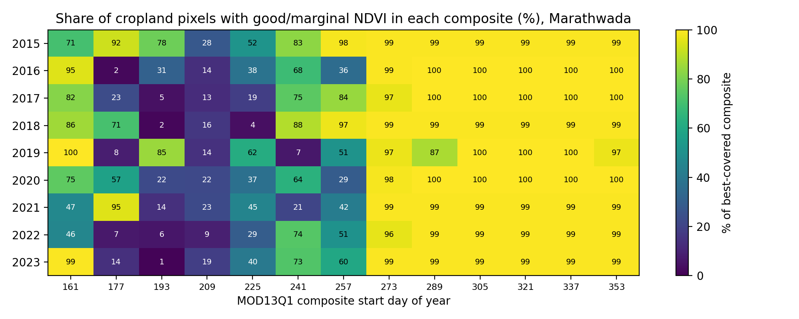

**Figure S1.** Share of cropland NDVI pixels passing the quality screen in each regional composite, and the regional season-range lag when composites below 10%, 25% or 50% coverage are excluded.

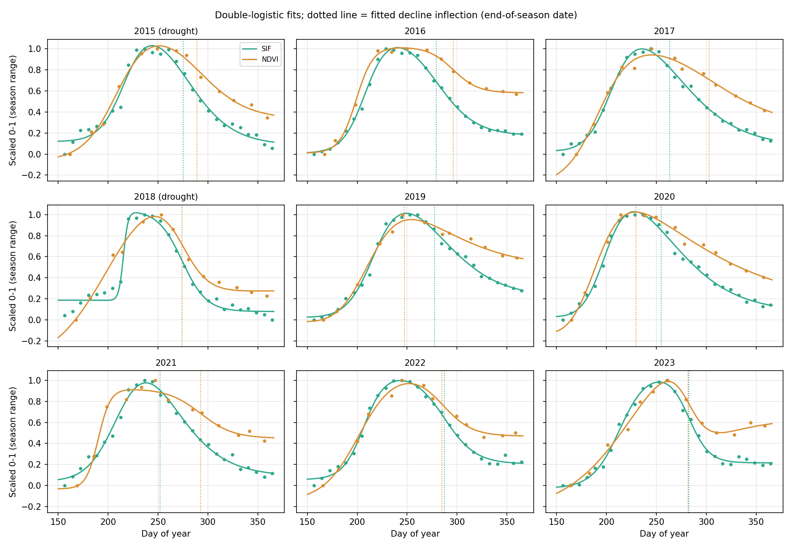

**Figure S2.** Asymmetric double-logistic fits to the regional SIF and NDVI series, by year, with the fitted end-of-season dates.

## Appendix A. Policy Extension: Combined Trigger Rules, the Cost of Their Errors and Other Drought Systems

*Added after the EarthArXiv preprint. This appendix uses only alarm and trigger dates already produced in this study. It does not change any result in the main text.*

### A.1 Why combine signals

The main text scores each signal on its own: the rainfall trigger, the NDVI anomaly and the SIF anomaly. The Manual for Drought Management does not use them on their own. It uses them in a sequence (Ministry of Agriculture & Farmers Welfare, 2016a). Trigger-1 is based on rainfall deviation, SPI and dry spells. Only if it is set off do states look at impact indicators (Trigger-2) in four groups: crop area sown, remote sensing (VCI or NDVI deviation), soil moisture and hydrology. States choose three of the four, and the drought is moderate or severe depending on how many of them are in the moderate or severe class. Field verification (Trigger-3) follows in a random 10% of affected villages, where an estimated crop loss of 33% or more counts as drought and more than 50% as severe drought. The state then declares drought by notification, for Kharif by 30 October.

In this design the satellite vegetation index can only confirm a drought that rainfall has already flagged. My results suggest that the rainfall step is the weak one. So I asked a policy-design question that the data can answer directly: which combination of the three signals catches the most drought district-years with the fewest false alarms, and how early?

### A.2 Method

I used the same 72 district-years as in Sections 4.2 and 4.9 (15 drought and 57 normal, each district against its own rainfall record), the same satellite alarms (z < −3 for two composites in a row) and the same rainfall trigger dates. Every rule fires on a date:

- **Single signals:** Trigger-1 on district-average rainfall; Trigger-1 when it has fired in 25% of a district's CHIRPS pixels; the rainfall deficit (> 25%) alone; the NDVI anomaly; the SIF anomaly.
- **AND rules** fire when the last of their signals has fired (deficit AND NDVI, deficit AND SIF, NDVI AND SIF).
- **A sequence rule** fires when the NDVI alarm comes on or after the rainfall deficit, which is the order the Manual uses (deficit, then NDVI confirms).
- **OR rules** fire with the first signal (NDVI OR SIF, Trigger-1 OR NDVI).
- **A 2-of-3 rule** fires on the date the second of deficit, NDVI and SIF fires.

For each rule I counted the drought district-years flagged, the false alarms in normal district-years, how many drought district-years were flagged by 30 September (the end of the monsoon window used for the dry-spell rule), and the median alarm date. I repeated the scoring with NDVI taken as observed instead of interpolated (Section 3.9), and for the satellite-only rules on the 2001–2014 district-years (Section 3.14). No rainfall rule can be scored for 2001–2014, because district daily CHIRPS was only extracted for 2015–2023. The script is `src/analysis/trigger_rule_comparison.py`, and the figure is made by `src/visualization/plot_trigger_rules.py`.

### A.3 Results

**Table A1.** Trigger rules scored on 72 district-years, 2015–2023 (satellite alarms at z < −3, own-district rainfall baseline).

| Rule | Drought flagged (of 15) | False alarms (of 57) | Flagged by 30 Sep | Median alarm date |
|---|---|---|---|---|
| Rainfall Trigger-1 (district average) | 2 | 1 | 1 | 25 Sep |
| Rainfall Trigger-1 (25% of pixels) | 2 | 1 | 2 | 17 Sep |
| Rainfall deficit > 25% alone | 10 | 18 | 9 | 16 Jul |
| NDVI anomaly | 13 | 4 | 9 | 17 Sep |
| SIF anomaly | 12 | 2 | 9 | 13 Sep |
| Deficit AND NDVI | 8 | 2 | 6 | 5 Sep |
| Deficit AND SIF | 7 | 0 | 6 | 24 Aug |
| Deficit, then NDVI confirms | 7 | 2 | 6 | 24 Aug |
| NDVI AND SIF | 12 | 2 | 9 | 17 Sep |
| NDVI OR SIF | 13 | 4 | 9 | 17 Sep |
| Trigger-1 OR NDVI | 13 | 5 | 9 | 17 Sep |
| 2 of 3: deficit, NDVI, SIF | 13 | 4 | 9 | 17 Sep |

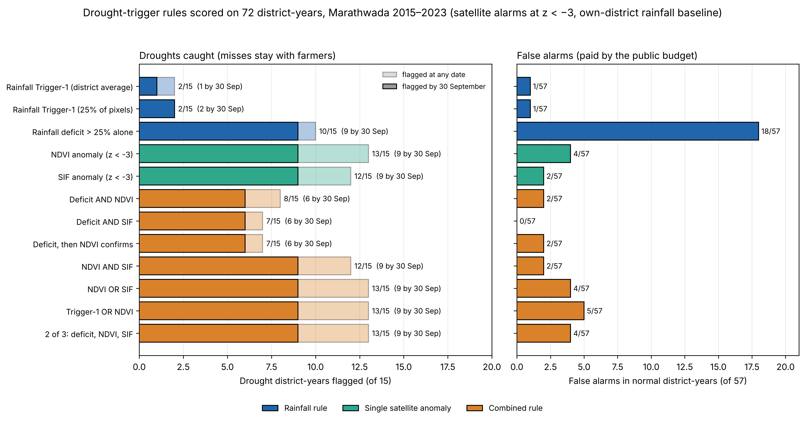
*Figure A1. Drought district-years flagged (left; dark part = flagged by 30 September) and false alarms in normal district-years (right) for each rule, 2015–2023.*

Four things stand out.

First, no combination flagged more drought district-years than the NDVI anomaly on its own (13 of 15). Every rule that uses a satellite signal missed Hingoli 2015 and Jalna 2023; the deficit alone flagged both, but with 18 false alarms. The OR rules flagged no more droughts than NDVI, and Trigger-1 OR NDVI added one false alarm.

Second, putting rainfall first cost about half the droughts. Rules that need the deficit (deficit AND NDVI, deficit AND SIF, deficit then NDVI) flagged 7 or 8 of 15. The deficit rule missed Aurangabad 2015 and four of the six drought district-years of 2018 (Jalna, Latur, Osmanabad, Parbhani), so any rule that waits for it misses them too. The rules that did fire fired earlier (median 24 August to 5 September), and deficit AND SIF had no false alarm. In this data, the order the Manual uses, rainfall first and vegetation as confirmation, limits detection to what the rainfall step can see.

Third, asking SIF to confirm NDVI halved the false alarms (from 4 to 2) without losing any drought flagged by 30 September (9 in both). The one extra miss, Nanded 2015, was flagged by NDVI only on 6 December. This does not hold up, though. With NDVI taken as observed, NDVI alone has 3 false alarms against 2 for NDVI AND SIF. In 2001–2014, requiring both indices flagged 2 of 40 drought district-years against 6 for NDVI alone, while NDVI alone had a single false alarm (Table A2). Where droughts are mild, confirmation costs detections.

Fourth, even the best rules flagged only 9 of the 15 drought district-years by 30 September, and the strict z < −3 threshold caught at most 7 of the 40 milder drought district-years of 2001–2014. The alarm threshold is itself a policy choice between missed droughts and false alarms, and these data only describe its consequences at one level.

**Table A2.** Sensitivity of the satellite rules.

| Rule | 2015–2023, NDVI as observed: drought (of 15) / false (of 57) | 2001–2014: drought (of 40) / false (of 72) |
|---|---|---|
| NDVI anomaly | 13 / 3 | 6 / 1 |
| SIF anomaly | 12 / 2 | 3 / 0 |
| NDVI AND SIF | 12 / 2 | 2 / 0 |
| NDVI OR SIF | 13 / 3 | 7 / 1 |

### A.4 What the errors cost

Counting errors treats a missed drought in a large district like one in a small district, and it leaves open how a missed drought should weigh against a false alarm. To put both errors in one unit, I valued them in rupees, as the relief they move.

For relief I used the SDRF/NDRF input subsidy for rainfed crops with a crop loss of 33% or more, ₹8,500 per hectare (norms for 2022–23 to 2025–26; Ministry of Home Affairs, 2022), on each district's mean Kharif sown area for 2015–2022 (Ministry of Agriculture & Farmers Welfare, 2024). In a drought district-year that a rule misses, this is relief withheld; in a normal district-year in which the rule fires, it is relief paid where there was no drought. Both are upper bounds, because relief goes only to farmers with a verified loss of 33% or more and to at most 2 ha per farmer. For scale I also valued the crop loss in each drought district-year: the shortfall of each Kharif crop's yield below its mean in that district's normal years of 2015–2022, times the area sown, at the 2022–23 Minimum Support Prices (Directorate of Economics & Statistics, 2025). The nine priced crops cover 98.9% of the Kharif area. Cotton is reported in bales of lint, which I converted at about 5 quintals of seed cotton per bale. District yields for 2023 are not yet published, so the loss for Jalna 2023 is imputed from the mean loss per hectare of the other drought district-years.

A rule's weighted cost is w × relief withheld + relief paid in normal years. The weight w says how much a rupee that fails to reach a drought-hit district counts against a rupee paid where there was no drought: at w = 1 only the budget counts, and w > 1 gives priority to drought-hit farmers. This is the logic of the cost–loss model for weather warnings (Murphy, 1977), with relief in place of protective action. Rather than choose w, I report the range of w over which each rule has the lowest cost. I scored the rules of Table A1, and the NDVI, SIF and NDVI AND SIF rules at z < −1.5, −2 and −3, counting a drought as flagged at any date and, separately, only if flagged by 30 September. The script is `src/analysis/trigger_cost_analysis.py`, and Figure A2 is made by `src/visualization/plot_trigger_costs.py`.

**Table A4.** The cost of each rule's errors, 2015–2023 (₹ crore; relief at ₹8,500/ha; drought flagged at any date). Selected rules; all are in `data/processed/trigger_cost_comparison.csv`.

| Rule | Drought flagged (of 15) / false alarms (of 57) | Relief withheld in missed droughts | Relief paid in normal years | Crop loss in missed droughts |
|---|---|---|---|---|
| Rainfall Trigger-1 (district average) | 2 / 1 | 6,593 | 689 | 22,141 |
| Rainfall deficit > 25% alone | 10 / 18 | 2,435 | 9,757 | 5,989 |
| NDVI anomaly, z < −1.5 | 15 / 24 | 0 | 12,725 | 0 |
| NDVI anomaly, z < −2 | 15 / 12 | 0 | 6,492 | 0 |
| NDVI AND SIF, z < −2 | 14 / 7 | 526 | 3,811 | 1,707 |
| NDVI anomaly, z < −3 | 13 / 4 | 889 | 2,336 | 2,904 |
| SIF anomaly, z < −3 (same as NDVI AND SIF) | 12 / 2 | 1,595 | 1,068 | 5,110 |
| Deficit, then NDVI confirms | 7 / 2 | 3,886 | 1,268 | 9,687 |
| Deficit AND SIF | 7 / 0 | 4,030 | 0 | 11,100 |

**Table A5.** The rule with the lowest weighted cost, by the weight w on relief withheld from drought-hit districts.

| w | Drought flagged at any date | w | Drought flagged by 30 September |
|---|---|---|---|
| below 0.44 | Deficit AND SIF | below 0.65 | Deficit AND SIF |
| 0.44–1.79 | SIF anomaly, z < −3 | 0.65–4.02 | SIF anomaly, z < −3 |
| 1.80–4.06 | NDVI anomaly, z < −3 | 4.03–5.83 | NDVI anomaly, z < −2 |
| 4.07–5.09 | NDVI AND SIF, z < −2 | 5.84 and above | NDVI anomaly, z < −1.5 |
| 5.10 and above | NDVI anomaly, z < −2 | | |

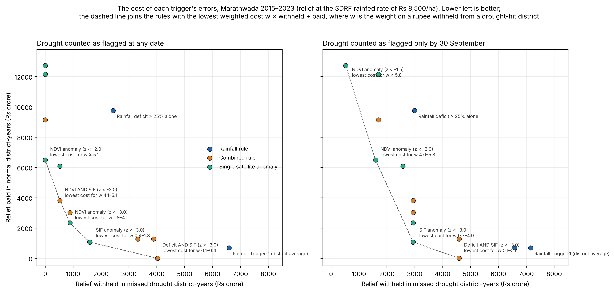
*Figure A2. Relief withheld in missed drought district-years against relief paid in normal district-years, for each rule, 2015–2023 (left: drought flagged at any date; right: only by 30 September). The dashed line joins the rules with the lowest weighted cost for some weight w.*

First, the scale. The 15 drought district-years lost about ₹25,450 crore of Kharif output at 2022–23 prices. Relief at the SDRF rate would have covered ₹7,843 crore of it (31%). The approximated rainfall Trigger-1 missed 13 of them: it would have withheld ₹6,593 crore of relief, and 87% of the crop loss (₹22,141 crore) fell in district-years in which it did not fire.

Second, a rainfall gate is the cheapest design only when a rupee that fails to reach a drought-hit district counts for less than half of a rupee paid in a normal year (w below 0.44, or 0.65 by 30 September). For any weight above that, a satellite rule without a rainfall gate costs less.

Third, which satellite rule is cheapest depends on w, so it is a value choice, not a technical one. For w between about 0.4 and 1.8, SIF at z < −3 is cheapest, because of its two fewer false alarms; between 1.8 and 4, NDVI at z < −3; above about 4 to 5, the looser z < −2. SIF's advantage rests on few events: in the checks of Table A2 it kept one false alarm fewer than NDVI, but in 2001–2014 it flagged half as many drought district-years (3 against 6 of 40).

Fourth, moving the threshold changes the cost more than changing the index. Going from NDVI at z < −3 to z < −2 cuts relief withheld from ₹889 crore to nothing and raises relief paid in normal years from ₹2,336 to ₹6,492 crore. Swapping NDVI for SIF at z < −3 moves the two by ₹706 and ₹1,268 crore. The threshold is a setting of the instrument, the index is the instrument itself (A.6).

### A.5 How other systems use vegetation signals

To put the Indian design in context, I compared it with four systems that use satellite vegetation or drought information in drought decisions, one of them in an EU member state. They differ in what the signal is allowed to decide, which is what matters for who carries each kind of error.

**Table A3.** Drought triggers in India and four other systems.

| | India: Manual for Drought Management | EU: European Drought Observatory, Combined Drought Indicator | USA: U.S. Drought Monitor and the Livestock Forage Disaster Program | Kenya: Kenya Livestock Insurance Program | Spain: river-basin drought plans and pasture-loss insurance |
|---|---|---|---|---|---|
| Signals | Rainfall deviation, SPI and dry spells; then three of crop sown area, VCI or NDVI deviation, soil moisture and hydrology; then field verification | SPI-1 and SPI-3, modelled soil moisture anomaly, fAPAR anomaly | Weekly county drought ratings from D0 to D4 | NDVI-based index of forage availability over the season, against its historical average | Plans: a prolonged-drought index from precipitation or natural flows, and a scarcity index from reservoir storage, flows and groundwater. Insurance: NDVI per homogeneous pasture zone, for each ten-day period, against its historical mean |
| Logic | Sequence: rainfall gate, then impact indicators, then field check | Sequence: Watch (rainfall deficit), Warning (plus soil moisture), Alert (plus vegetation) | Fixed schedule: 4 weeks of D2 gives one monthly payment, more severe or longer drought gives up to five | Vegetation index alone triggers the payout | Plans: index thresholds move each unit from normal to pre-alert, alert and emergency, each stage with set measures. Insurance: NDVI alone; payment below the mean minus 0.7 or 1.5 standard deviations (standard option) |
| What it decides | State declaration and relief (SDRF/NDRF) | Monitoring and early warning only; no payments | Payments to livestock producers | Insurance payouts to pastoralists | Plans: water-allocation measures, and less demanding ecological flows in a prolonged drought. Insurance: payouts to livestock farmers, premiums subsidised by ENESA |
| Unit | Village, block, taluka or district, as notified | 5 km grid | County | Insurance unit within a county | Plans: territorial unit within a river basin. Insurance: homogeneous pasture zone |
| Who carries a missed drought | Farmers, until field verification catches up | No direct payment at stake | Producers in counties rated below the threshold | Pastoralists whose forage loss the index does not see | Plans: water users in the unit. Insurance: livestock farmers whose pasture loss the zone index does not see |
| Source | Ministry of Agriculture & Farmers Welfare (2016a) | Sepulcre-Canto et al. (2012); Copernicus European Drought Observatory (n.d.) | USDA Farm Service Agency (n.d.) | WOCAT (n.d.) | Estrela (2017); Ministerio de Agricultura, Pesca y Alimentación (2020) |

The EU indicator uses the same order as India, rainfall first and vegetation last, but it decides nothing about money. The U.S. and Kenyan programmes, and Spain's pasture insurance, tie payments to a satellite or expert rating directly, with no field verification step, which makes them fast but means that the index error falls on the farmer or herder whose field the index does not represent (basis risk). My results do not show which design is better; they show that in Marathwada a rainfall gate in front of the vegetation index would have hidden roughly half of the drought district-years that the vegetation index alone flagged.

Spain, an EU member state, uses both designs side by side, for different goals. Its river-basin drought plans follow a sequence of indices, like the EU indicator, and the measures they trigger concern water: in a prolonged drought, less demanding ecological flows and a justified temporary deterioration of water bodies; under scarcity, the measures set for each stage from pre-alert to emergency (Estrela, 2017). For livestock farmers, the pasture-loss insurance pays out on NDVI alone, starting below the zone's historical mean minus 0.7 standard deviations in the standard option (Ministerio de Agricultura, Pesca y Alimentación, 2020). That threshold is far looser than the z < −3 used here. In Marathwada, NDVI at z < −1.5 flagged all 15 drought district-years but also 24 of 57 normal ones (Table A4), a trade that is never the cheapest when a flag at any date counts, and is the cheapest only at a weight on missed droughts of about 6 or more when only flags by 30 September count. The two thresholds are not strictly comparable, since my baseline uses only normal years and needs two composites in a row.

In the classification of policy tools by Hood (1983), India's drought response uses all four types: information (nodality) in the satellite and rainfall monitoring, authority in the Manual's trigger rules and the state notification, treasure in SDRF/NDRF relief and PMFBY payouts, and organisation in the district drought contingency cells and the field verification teams. The satellite signals in this study enter only through nodality. Whether they should also gain authority, by triggering a decision as in the U.S., Kenyan and Spanish insurance programmes, is the policy question this study can inform but not settle.

### A.6 Three orders of policy change

Hall (1993) distinguishes three orders of policy change: the settings of existing instruments (first order), the instruments themselves (second order), and the goals behind them (third order). The proposals in and around this study fall into all three.

- **First order: settings.** The alarm threshold (z < −3 or −2), the rainfall deficit (25%) and dry-spell length (21 days), and whether the trigger is computed on district averages or per pixel. In this data, first-order changes move the cost of errors most (A.4), while no setting of the rainfall rule both catches droughts and stays quiet in normal years (Section 4.9).
- **Second order: instruments and how they are combined.** Adding SIF, or replacing the rainfall gate with an OR or 2-of-3 rule. The evidence is against adding SIF for earlier warning (Section 4.2) and against a rainfall gate in front of the vegetation index (A.3, A.4).
- **Third order: the goal.** India's drought response aims to compensate verified loss: the satellite index informs and field verification decides. The U.S., Kenyan and Spanish insurance programmes aim to pay quickly against an index, and accept that some will be paid without a loss and others not paid despite one. Giving a satellite index authority in India would be a third-order change.

This study can inform the third-order question with how often and how early an index would have been right, and what its errors would have cost. It cannot settle it. In Hall's account, a change of goals does not follow from technical evidence alone; it comes out of a contest over the goals themselves.

### A.7 Limitations of this extension

The rules are scored on the same 72 district-years, in which only two drought seasons (2015 and 2018) supply 14 of the 15 drought cases, and district-years within one season are not independent. The satellite alarms are retrospective, because their normal years include later years (Section 6). The rainfall trigger is approximated on district-average rainfall and per CHIRPS pixel, not per taluka with field inputs, and SPI and the Trigger-2 categories other than vegetation are not modelled. The costs in A.4 apply a flat relief rate to each district's whole Kharif area, which overstates both errors, since relief goes only to farmers with a verified loss of 33% or more and to at most 2 ha each. They leave out PMFBY payouts, which scale with the insured loss, and the cost of field verification. Crop losses are valued at one year's support prices, cotton through an approximate conversion, and the 2023 loss is imputed. The weight w is left open on purpose; the results show where the choice of rule changes, not which weight is right. The comparison in A.5 describes the published design of each system, not how well each performs.

## References

Badgley, G., Field, C. B., & Berry, J. A. (2017). Canopy near-infrared reflectance and terrestrial photosynthesis. *Science Advances*, 3(3), e1602244. [https://doi.org/10.1126/sciadv.1602244](https://doi.org/10.1126/sciadv.1602244)

Copernicus European Drought Observatory. (n.d.). *Combined Drought Indicator (CDI)* [Factsheet]. European Commission, Joint Research Centre. [https://drought.emergency.copernicus.eu/data/factsheets/factsheet_combinedDroughtIndicator.pdf](https://drought.emergency.copernicus.eu/data/factsheets/factsheet_combinedDroughtIndicator.pdf)

Deccan Herald. (2018, October 23). *Drought-like situation declared in 180 tehsils*. [https://www.deccanherald.com/india/drought-situation-declared-180-699467.html](https://www.deccanherald.com/india/drought-situation-declared-180-699467.html)

Dechant, B., Ryu, Y., Badgley, G., Zeng, Y., Berry, J. A., Zhang, Y., Goulas, Y., Li, Z., Zhang, Q., Kang, M., Li, J., & Moya, I. (2020). Canopy structure explains the relationship between photosynthesis and sun-induced chlorophyll fluorescence in crops. *Remote Sensing of Environment*, 241, 111733. [https://doi.org/10.1016/j.rse.2020.111733](https://doi.org/10.1016/j.rse.2020.111733)

Didan, K. (2021). *MODIS/Terra Vegetation Indices 16-Day L3 Global 250m SIN Grid V061* [Data set]. NASA EOSDIS Land Processes Distributed Active Archive Center. [https://doi.org/10.5067/MODIS/MOD13Q1.061](https://doi.org/10.5067/MODIS/MOD13Q1.061)

Directorate of Economics & Statistics, Ministry of Agriculture & Farmers Welfare, Government of India. (2025). *Minimum Support Prices (MSP) statement* [As on 12.12.2025]. [https://desagri.gov.in/wp-content/uploads/2025/12/MSP-Statement_English_As-on-12.12.2025.pdf](https://desagri.gov.in/wp-content/uploads/2025/12/MSP-Statement_English_As-on-12.12.2025.pdf)

Down To Earth. (2025). *When crop insurance fails farmers: Why India's PMFBY scheme needs urgent reform*. [https://www.downtoearth.org.in/agriculture/when-crop-insurance-fails-farmers-pmfby-needs-a-rethink](https://www.downtoearth.org.in/agriculture/when-crop-insurance-fails-farmers-pmfby-needs-a-rethink)

Economic and Political Weekly. (2018). Drought in Maharashtra [Editorial]. *Economic and Political Weekly*, 53(48). [https://www.epw.in/journal/2018/48/editorials/drought-maharashtra.html](https://www.epw.in/journal/2018/48/editorials/drought-maharashtra.html)

Estrela, T. (2017). *Aspectos básicos de los Planes Especiales de Sequía* [Presentation]. Confederación Hidrográfica del Júcar. [https://www.chj.es/es-es/ciudadano/participacion_publica/Documents/PES%202017/Teodoro_Estrela_Presentacion_Aspectos_Basicos_PES.pdf](https://www.chj.es/es-es/ciudadano/participacion_publica/Documents/PES%202017/Teodoro_Estrela_Presentacion_Aspectos_Basicos_PES.pdf)

Food and Agriculture Organization of the United Nations (FAO). (2015). *FAO GAUL (Global Administrative Unit Layers): Global Administrative Unit Layers 2015, Level 2* [Data set]. Google Earth Engine Data Catalog. [https://developers.google.com/earth-engine/datasets/catalog/FAO_GAUL_2015_level2](https://developers.google.com/earth-engine/datasets/catalog/FAO_GAUL_2015_level2)

Friedl, M., & Sulla-Menashe, D. (2022). *MODIS/Terra+Aqua Land Cover Type Yearly L3 Global 500m SIN Grid V061* [Data set]. NASA EOSDIS Land Processes Distributed Active Archive Center. [https://doi.org/10.5067/MODIS/MCD12Q1.061](https://doi.org/10.5067/MODIS/MCD12Q1.061)

Funk, C., Peterson, P., Landsfeld, M., Pedreros, D., Verdin, J., Shukla, S., Husak, G., Rowland, J., Harrison, L., Hoell, A., & Michaelsen, J. (2015). The climate hazards infrared precipitation with stations—a new environmental record for monitoring extremes. *Scientific Data*, 2, Article 150066. [https://doi.org/10.1038/sdata.2015.66](https://doi.org/10.1038/sdata.2015.66)

Guanter, L., Bacour, C., Schneider, A., Aben, I., van Kempen, T. A., Maignan, F., Retscher, C., Köhler, P., Frankenberg, C., Joiner, J., & Zhang, Y. (2021). The TROPOSIF global sun-induced fluorescence dataset from the Sentinel-5P TROPOMI mission. *Earth System Science Data*, 13, 5423–5440. [https://doi.org/10.5194/essd-13-5423-2021](https://doi.org/10.5194/essd-13-5423-2021)

Hall, P. A. (1993). Policy paradigms, social learning, and the state: The case of economic policymaking in Britain. *Comparative Politics*, 25(3), 275–296. [https://doi.org/10.2307/422246](https://doi.org/10.2307/422246)

Hood, C. (1983). *The Tools of Government*. Macmillan.

Huete, A., Didan, K., Miura, T., Rodriguez, E. P., Gao, X., & Ferreira, L. G. (2002). Overview of the radiometric and biophysical performance of the MODIS vegetation indices. *Remote Sensing of Environment*, 83(1–2), 195–213. [https://doi.org/10.1016/S0034-4257(02)00096-2](https://doi.org/10.1016/S0034-4257(02)00096-2)

India.com / ANI. (2015, October 16). *Maharashtra: Drought declared in 14,708 villages*. [https://www.india.com/news/india/maharashtra-drought-declared-in-14708-villages-state-government-waves-off-school-students-fees-637146/](https://www.india.com/news/india/maharashtra-drought-declared-in-14708-villages-state-government-waves-off-school-students-fees-637146/)

Jönsson, P., & Eklundh, L. (2004). TIMESAT—a program for analyzing time-series of satellite sensor data. *Computers & Geosciences*, 30(8), 833–845. [https://doi.org/10.1016/j.cageo.2004.05.006](https://doi.org/10.1016/j.cageo.2004.05.006)

Li, X., & Xiao, J. (2019). A global, 0.05-degree product of solar-induced chlorophyll fluorescence derived from OCO-2, MODIS, and reanalysis data. *Remote Sensing*, 11(5), 517. [https://doi.org/10.3390/rs11050517](https://doi.org/10.3390/rs11050517)

Ministerio de Agricultura, Pesca y Alimentación, Entidad Estatal de Seguros Agrarios (ENESA). (2020). *Seguro de compensación por pérdida de pastos* [Information note]. [https://servicio.mapa.gob.es/en/enesa/publicaciones/notapastos-mapa2020_je_tcm38-542028.pdf](https://servicio.mapa.gob.es/en/enesa/publicaciones/notapastos-mapa2020_je_tcm38-542028.pdf)

Ministry of Agriculture & Farmers Welfare, Government of India. (2016a). *Manual for Drought Management*. Department of Agriculture, Cooperation & Farmers Welfare, New Delhi.

Ministry of Agriculture & Farmers Welfare, Government of India. (2016b). *Pradhan Mantri Fasal Bima Yojana (PMFBY)*. Retrieved from [https://pmfby.gov.in](https://pmfby.gov.in)

Ministry of Agriculture & Farmers Welfare, Government of India. (2024). *Crop Wise Area Production Yield* [Data set]. India Data Portal. [https://indiadataportal.com/p/area-production-yield-apy](https://indiadataportal.com/p/area-production-yield-apy)

Ministry of Home Affairs, Government of India. (2022). *Items and norms of assistance from the State Disaster Response Fund (SDRF) and National Disaster Response Fund (NDRF), 2022-23 to 2025-26*. [https://kokrajhar.assam.gov.in/sites/default/files/public_utility/Revised%20SDRF%20Norms%20%26%20Assistance.pdf](https://kokrajhar.assam.gov.in/sites/default/files/public_utility/Revised%20SDRF%20Norms%20%26%20Assistance.pdf)

Mohammed, G. H., Colombo, R., Middleton, E. M., Rascher, U., van der Tol, C., Nedbal, L., Goulas, Y., Pérez-Priego, O., Damm, A., Meroni, M., Joiner, J., Cogliati, S., Verhoef, W., Malenovský, Z., Gastellu-Etchegorry, J.-P., Miller, J. R., Guanter, L., Moreno, J., Moya, I., … Zarco-Tejada, P. J. (2019). Remote sensing of solar-induced chlorophyll fluorescence (SIF) in vegetation: 50 years of progress. *Remote Sensing of Environment*, 231, 111177. [https://doi.org/10.1016/j.rse.2019.04.030](https://doi.org/10.1016/j.rse.2019.04.030)

Morung Express / IANS. (2023, October 31). *Maharashtra declares drought in 40 talukas*.

Murphy, A. H. (1977). The value of climatological, categorical and probabilistic forecasts in the cost-loss ratio situation. *Monthly Weather Review*, 105(7), 803–816. [https://doi.org/10.1175/1520-0493(1977)105<0803:TVOCCA>2.0.CO;2](https://doi.org/10.1175/1520-0493(1977)105<0803:TVOCCA>2.0.CO;2)

Porcar-Castell, A., Tyystjärvi, E., Atherton, J., van der Tol, C., Flexas, J., Pfündel, E. E., Moreno, J., Frankenberg, C., & Berry, J. A. (2014). Linking chlorophyll a fluorescence to photosynthesis for remote sensing applications: mechanisms and challenges. *Journal of Experimental Botany*, 65(15), 4065–4095. [https://doi.org/10.1093/jxb/eru191](https://doi.org/10.1093/jxb/eru191)

Sepulcre-Canto, G., Horion, S., Singleton, A., Carrao, H., & Vogt, J. (2012). Development of a Combined Drought Indicator to detect agricultural drought in Europe. *Natural Hazards and Earth System Sciences*, 12(11), 3519–3531. [https://doi.org/10.5194/nhess-12-3519-2012](https://doi.org/10.5194/nhess-12-3519-2012)

Song, L., Guanter, L., Guan, K., You, L., Huete, A., Ju, W., & Zhang, Y. (2018). Satellite sun-induced chlorophyll fluorescence detects early response of winter wheat to heat stress in the Indian Indo-Gangetic Plains. *Global Change Biology*, 24(9), 4023–4037. [https://doi.org/10.1111/gcb.14302](https://doi.org/10.1111/gcb.14302)

Sun, Y., Fu, R., Dickinson, R., Joiner, J., Frankenberg, C., Gu, L., Xia, Y., & Fernando, N. (2015). Drought onset mechanisms revealed by satellite solar-induced chlorophyll fluorescence: Insights from two contrasting extreme events. *Journal of Geophysical Research: Biogeosciences*, 120(11), 2427–2440. [https://doi.org/10.1002/2015JG003150](https://doi.org/10.1002/2015JG003150)

USDA Farm Service Agency. (n.d.). *Livestock Forage Disaster Program (LFP)*. [https://www.fsa.usda.gov/resources/disaster-recovery/livestock-forage-disaster-program-lfp](https://www.fsa.usda.gov/resources/disaster-recovery/livestock-forage-disaster-program-lfp)

WOCAT. (n.d.). *Kenya Livestock Insurance Program (KLIP)* [Approach]. WOCAT Global SLM Database. [https://qcat.wocat.net/wocat/approaches/view/approaches_3283](https://qcat.wocat.net/wocat/approaches/view/approaches_3283)

Yoshida, Y., Joiner, J., Tucker, C., Berry, J., Lee, J.-E., Walker, G., Reichle, R., Koster, R., Lyapustin, A., & Wang, Y. (2015). The 2010 Russian drought impact on satellite measurements of solar-induced chlorophyll fluorescence: Insights from modeling and comparisons with parameters derived from satellite reflectances. *Remote Sensing of Environment*, 166, 163–177. [https://doi.org/10.1016/j.rse.2015.06.008](https://doi.org/10.1016/j.rse.2015.06.008)

Zee News. (2018, October 31). *Maharashtra declares drought in 151 talukas in 26 districts*. [https://zeenews.india.com/india/maharashtra-declares-drought-in-151-talukas-in-26-districts-2152281.html](https://zeenews.india.com/india/maharashtra-declares-drought-in-151-talukas-in-26-districts-2152281.html)

Zhang, X., Friedl, M. A., Schaaf, C. B., Strahler, A. H., Hodges, J. C. F., Gao, F., Reed, B. C., & Huete, A. (2003). Monitoring vegetation phenology using MODIS. *Remote Sensing of Environment*, 84(3), 471–475. [https://doi.org/10.1016/S0034-4257(02)00135-9](https://doi.org/10.1016/S0034-4257(02)00135-9)
